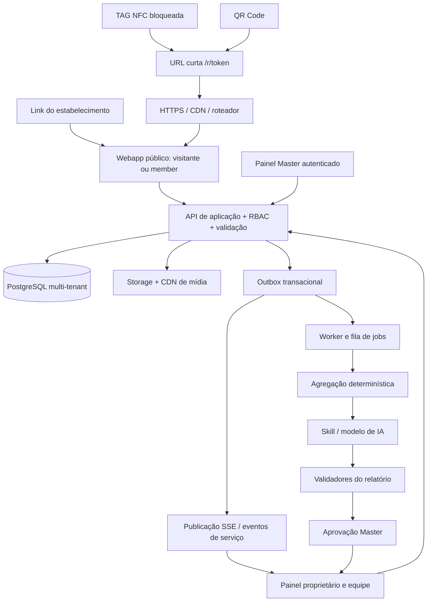
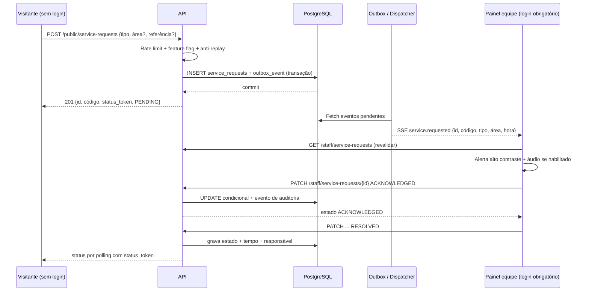

# SEMRESERVAS — DOCUMENTO MESTRE CONSOLIDADO v4.0

**Identidade oficial APROVADA:**  
# SEMRESERVAS  
**Marketing de relacionamento gastronômico**  
*Um toque. Infinitas possibilidades.*

**Atualizado em 04/11/2026 · Fonte principal para análise externa, planejamento e handoff de desenvolvimento.**

## Hierarquia normativa e premissas

1. O Documento Mestre de Conhecimento v2.0 (28/10/2026) foi a base do projeto; a presente versão incorpora decisões posteriores e **prevalece sobre os trechos incompatíveis**.
2. Identidade **aprovada**: nome, descritor e slogan acima; usar logo gráfico aprovado sem redesenho.
3. Experiência NFC/QR no salão é o coração da primeira implantação; delivery é complementar, e não prioridade comercial sobre o salão.
4. O primeiro sistema demonstrável será o RESTOPUB, estabelecimento fictício. A PULPO será piloto real após validação do MVP; qualquer produto, preço, paleta ou identidade atribuídos à PULPO no protótipo são **simulações até homologação**.
5. TAGs não determinam mesas fixas: displays podem ser movimentados; o garçom confere a mesa presencialmente. A fila de atendimento precisa solucionar a identificação do local sem supor mesa por TAG.
6. **Acesso sem login** para home, cardápio/feed, ingredientes, vídeos, seleção, apresentação ao garçom, Instagram, Google, Wi-Fi de convidados, fotos com moldura, compartilhamento iniciado, pesquisa anônima e solicitação de atendimento com proteção antiabuso. **Login somente para dados e benefícios pessoais persistentes**, carteira, pontos, recompensas; moderação/identificação para comentários públicos persistentes; equipe, dono e Master sempre autenticados.
7. O painel do proprietário tem **fila de chamado com alerta visual dominante, sinal sonoro ativado por gesto do operador, estados auditáveis e fallback**. Não prometer alerta sonoro com navegador fechado ou silenciado.
8. Resultados mensuráveis: engajamento, uso, clique externo, relações e créditos verificados. **Não inferir vendas efetivas, faturamento, avaliações Google publicadas, seguidores ou curtidas Instagram** a partir desses eventos.
9. Relatório mensal SEMRESERVAS Insights proativo, com gráficos inteligíveis, hipóteses e recomendações por IA + validação e revisão. Geração automatizada e supervisão humana conforme necessidade.
10. Preços, planos e período experimental de 30 dias permanecem **propostos/pedentes de validação comercial**, não são termos aprovados finais.
11. A arquitetura, endpoints e esquema SQL deste pacote são **propostas para análise do Claude Code**; nenhuma escolha de stack pode ser tratada como implementação pronta.

## Mudanças formais em relação ao Documento Mestre v2.0

| Área | Atualização | Status |
|---|---|---|
| Nome, descritor, slogan | SEMRESERVAS / Marketing de relacionamento gastronômico / Um toque. Infinitas possibilidades. | APROVADO |
| Marca gráfica | usar a arte de S/NFC oficial fornecida, sem nova estilização | APROVADO |
| Valor central | engajamento digital, fidelização e relatórios com insights, não uma plaqueta NFC isolada | APROVADO |
| Fluxo de entrada | NFC/QR sem login obrigatório, com identificação progressiva | DIRETRIZ ATUAL |
| TAG na mesa | não vincular número fixo de mesa | APROVADO |
| Pedido presencial | visualização para garçom sem preços; equipe confirma o pedido | APROVADO |
| Chamar garçom | painel destacado e aviso sonoro permitido pelo navegador; fila confiável | REQUISITO |
| Home | customizável pelo Master sem fork por restaurante | REQUISITO |
| UI do prato | feed vertical de imagens/vídeos e legenda expansível, filtro por categoria; 4+ itens por categoria na demo | DIRETRIZ UX |
| Programa de fidelização | identificação, carteira e validação de crédito; sem recompensar avaliação Google | DIRETRIZ ATUAL |
| PULPO | piloto após RESTOPUB/MVP; conteúdo real a homologar | APROVADO/PENDENTE |

---


# PARTE II — ESCOPO E ESPECIFICAÇÃO TÉCNICA INTEGRAL

# SEMRESERVAS — DOCUMENTO TÉCNICO INTEGRAL PARA REVISÃO DE IA

**Pacote MVP Handoff v1.0 · 04/11/2026 · PROPOSTA EM REVISÃO**

Este arquivo concatena os nove documentos do handoff; os arquivos originais e contratos são entregues separadamente. Os termos de status em cada seção prevalecem.

---


---

<!-- FONTE: documentacao/01_ESCOPO_PRODUTO_E_DECISOES.md -->

# 01 — Documento consolidado de escopo e decisões

**SEMRESERVAS — Marketing de relacionamento gastronômico**  
**Versão:** handoff técnico v1.0 / 04-11-2026  
**Natureza:** especificação consolidada para revisão antes do MVP; não são funcionalidades já implementadas.

## 1. Identidade do negócio

A SEMRESERVAS é um serviço SaaS multiestabelecimento para aproximar clientes de restaurantes, bares, pizzarias, cafeterias e gelaterias por meio de experiências digitais acessadas por **TAGs NFC**, QR Code e links. O núcleo de valor é gerar **interação mensurável, relacionamento, fidelização e inteligência de marketing** para o negócio; a TAG é o canal físico mais reconhecível, não o produto inteiro.

A SEMRESERVAS complementa sistemas de PDV, caixa, estoque, cozinha, gestão fiscal e logística existentes. Não os substitui e não contabiliza vendas sem validação confiável. Não faz reservas de mesas. Não requer aplicativo nativo. O consumidor usa navegador no telefone.

### Três pilares aprovados

- **Experiência:** descoberta visual do cardápio, feed com fotos/vídeos, produtos expandidos, ingredientes, montagem de seleção e acesso a serviços.
- **Relacionamento:** clube, pontos, recompensas, campanhas, pesquisas, sugestões e participação nas interações.
- **Inteligência:** coleta proporcional de eventos, indicadores de engajamento, relatórios mensais com recomendações produzidas por IA e conferência.

### Objetivo comercial B2B

O cliente contratante é o **dono ou gestor** do estabelecimento, não o consumidor final. A venda inicial acontece presencialmente em Bagé/RS, demonstrando no próprio celular a experiência NFC no display de acrílico. O relatório mensal entregue proativamente ajuda a traduzir as interações em oportunidades de marketing, sem prometer aumento de faturamento.

### Execução confirmada

- Desenvolvimento conduzido pelo fundador com apoio de ferramentas de IA; sem terceirização integral prevista.
- Criação do **SEMRESERVAS RESTOPUB**, estabelecimento fictício funcional usado como laboratório e demonstração.
- Após protótipo e MVP estáveis, **PULPO Cozinha Criativa**, em Bagé/RS, será o primeiro piloto real proposto.
- Início comercial local e consultivo, porta a porta.

## 2. Marca e personalização

Usar **sem redesenhar** o logo aprovado fornecido pelo projeto: símbolo S com ondas NFC em laranja, palavra SEM em roxo e RESERVAS em laranja, tipografia aprovada. A customização do webapp deve colocar a **marca do estabelecimento em primeiro plano**, mantendo uma identificação discreta SEMRESERVAS/contato em rodapé ou área "Sobre a tecnologia". Nenhuma customização deve demandar fork de código: tokens visuais, logotipo, banner, textos, ordem de seções, categorias, módulos e mídias são dados da unidade.

Para o RESTOPUB, há uma identidade demonstrativa com roxo/laranja. Para a PULPO, cores e conteúdo são **proposta visual temporária**: o Instagram não pôde ser consultado integralmente neste ambiente; nenhum logo, fotografia, preço ou cardápio foi validado pelo estabelecimento. O protótipo distingue isso claramente.

## 3. Contextos de acesso

1. **Mesa/salão:** TAG NFC 213 e QR Code, com URL curta pública que identifica a origem/estabelecimento, **sem número de mesa obrigatório**. O display pode circular pelas mesas; o garçom anota a mesa ao atender.
2. **Casa/delivery:** ímã com NFC apropriado para metal e QR, link público ou site do restaurante; montagem e encaminhamento de pedido a WhatsApp, sem pagamento online inicial (no roadmap, sujeito à priorização).
3. **Sites e campanhas:** URL contextualizada, com origem rastreável quando possível.

Os identificadores NFC/QR não autenticam pessoas. A URL é permanente e reatribuível no servidor se o suporte retornar. Depois de gravada e testada, a TAG deve ser bloqueada contra regravação; não tratar o bloqueio como prova de autenticidade criptográfica da origem.

## 4. O que o cliente faz SEM login

Acesso ao estabelecimento via NFC/QR/site; Home; cardápio; fotos/vídeos/ingredientes; busca e filtros por categoria dentro do feed; montar e revisar seleção; apresentar pedido ao garçom (em tela de contraste elevado **sem preços**); iniciar chamado de atendimento/conta; abrir Instagram; abrir link de avaliação espontânea no Google; ver dados de Wi-Fi de convidados e copiar senha; ver campanhas e benefícios públicos; abrir pesquisa interna opcional; gerar fotos com molduras e baixar/compartilhar; compartilhar produtos; curtir e favoritar localmente com limites antifraude (não são compras validadas).

Uma visita anônima não deve ser bloqueada por modal de cadastro. O app pode criar identificador de sessão pseudônimo de curta duração para antifraude e métricas agregadas, observando privacidade e transparência.

## 5. O que EXIGE identidade e/ou validação

- **Carteira de pontos**, histórico pessoal, acumulação associada à pessoa e resgate: identificação e pertencimento ao clube; crédito depende de regra e validação servidor/equipe.
- **Comentários públicos persistentes** associados a perfil: preferir conta identificada, moderação e regras de convivência. Avaliação interna de prato com selo "compra verificada" exige prova de consumo; outros depoimentos sem verificação devem ser rotulados.
- **Ações internas pontuáveis:** usuário identificado e critérios objetivos; pesquisa anônima pode existir, mas não pontua.
- **Gestor, operador de atendimento e admin Master:** autenticação segura e autorização por papel/estabelecimento.
- **Marketing personalizado:** autorização/hipótese legal apropriada por finalidade; login não implica consentimento publicitário.

Não condicionar a avaliação pública no Google a login na SEMRESERVAS nem dar pontos, brinde ou qualquer vantagem por isso. Não afirmar que cliques no Instagram comprovam curtidas/seguidores.

## 6. Experiência do consumidor: estrutura aprovada para esta proposta de UI

- **Home inicial personalizada** por estabelecimento, mostrando as 4 ações mais relevantes com rótulos legíveis (cardápio, pedido, clube, chamar garçom) e grupos secundários (presença digital, serviços/conexão, experiências/pesquisas).
- **Rodapé fixo** com Início, Cardápio, Pedido, Clube e Serviços; cabeçalho compacto com marca do estabelecimento e ações rápidas.
- **Cardápio em feed vertical** tipo Instagram/Reels. Foto ou vídeo; nome e preço destacados; descrição/ingredientes apresentados em gradiente sobre a mídia, expansíveis por toque/deslize; curtidas, comentário, favorito, compartilhar e botão primário adicionar ao pedido.
- **Categorias visíveis como chips/destaques**, com seleção filtrando o feed. Não existe tela obrigatória de cardápio em lista por categoria nesta versão.
- **Pelo menos 4 produtos de demonstração por categoria** no RESTOPUB e PULPO, com mídias ilustrativas quando não há fotografias reais.
- **Pedido do cliente:** quantidades, observações e subtotal estimado; **modo garçom** exibido somente após clique, com itens/quantidades/código de apresentação, sem preço. Abaixo da lista deve haver botão "Chamar garçom".
- **Chamado de garçom:** sinal visual muito destacado e som no painel operacional após ativação humana do áudio. Sem mesa vinculada ao QR/NFC, solicitar região aproximada/descrição opcional e oferecer código de 4 caracteres/dígitos a ser mostrado; confirmar presencialmente. A viabilidade operacional precisa ser testada na PULPO antes de habilitar no local.

## 7. Três áreas do sistema

**A. Webapp do consumidor:** experiência pública, interações, seleção de pedido, clube, serviços e mídia. Exibição e capacidades dependem da configuração da unidade.

**B. Painel Master SEMRESERVAS:** criar/gerir estabelecimentos e unidades; status de teste/ativo/pausado; publicação da Home; configuração de identidade; importação de produtos; catálogo de mídia; feature flags; NFC/QR; usuários e permissões; suporte, operações; custos; fila e aprovação dos relatórios. Mudanças de configuração chegam ao consumidor sem fork ou nova compilação.

**C. Painel do proprietário/equipe:** indicadores e relatórios claros, engajamento por produto, campanhas, clube e recompensas, pesquisas e comentários, operação de atendimento e alertas. O proprietário não gerencia clientes de outros estabelecimentos. O painel pode exibir funções distintas para proprietário, gerente e atendente, conforme papel.

## 8. Recurso crítico: fila de atendimento

O "chamar garçom" não pode ser um botão cosmético. A aplicação precisa ter confirmação real de recebimento e fila monitorada, com estados `PENDING → ACKNOWLEDGED → RESOLVED` (ou `CANCELLED`/`EXPIRED` quando aplicável), registros de tempo e responsável, deduplicação e indicadores. O painel exibe alerta de prioridade alta, contador, área informada, código, momento da chamada e botões para assumir/concluir. O áudio só pode ser prometido após o operador habilitar o som, e a operação deve ter alternativa visual sempre disponível.

**Risco pendente:** sem número fixo de mesa e sem localização indoor, o sistema não sabe onde a pessoa está. A solução mínima proposta é código + área aproximada opcional + conferência humana. Se isso se mostrar insuficiente, o recurso fica desabilitado até haver solução operacional — sem renunciar à portabilidade dos displays.

## 9. Relatório mensal com IA e revisão humana

O proprietário terá dashboard e receberá periodicamente um relatório proativo, gerado a partir de contagens verificáveis, com análise assistida por IA e conferência. O relatório apresenta: acessos, origem NFC/QR/site, exploração e mídia de produtos, curtidas/favoritos/quero provar, comentários moderados, pesquisas e sugestões, clube e pontos validados, recompensas, chamadas atendidas e seus tempos, participação em campanhas, links externos, fotos e molduras (aberturas, artes geradas, downloads e compartilhamentos iniciados). Cada insight responde: **o que observamos, o que isso pode significar, o que testar e como medir**; deve expor amostra, limites e ausência de dados.

**Sem vendas presumidas.** Não interpretar pedido montado como venda. Sem PDV integrado, nenhuma receita ou aumento de faturamento pode ser atribuído à SEMRESERVAS. Não confundir clique para Google com avaliação publicada; nem clique em Instagram com curtida/seguidor.

## 10. Sequência de implantação

**Marco 0 — materiais:** homologar TAG 213, TAG 215 blindada para metal, displays, gravação de URL e bloqueio permanente após testes. **Marco 1 — RESTOPUB funcional:** todas as principais jornadas simuladas e integração das três áreas. **Marco 2 — MVP operacional:** multiestabelecimento, autorização, NFC/QR, cardápio, pedido presencial, telemetria confiável, publicação/feature flags, clube básico e relatórios. **Marco 3 — piloto PULPO:** obter dados, marca, cardápio e consentimentos reais; operar com equipe treinada e medir adoção. **Marco 4 — Bagé:** venda presencial com demonstração e teste comercial controlado.

## 11. Comercial: valores são apenas referência

Tabelas anteriores citavam planos Iniciante/Presença/Relacionamento/Negócios, Delivery e SEMRESERVAS Social. Após reavaliações, houve proposta de plano principal mais simples, sem aprovação comercial definitiva. **Não programar preços rígidos ou planos por nome no front-end.** Modelar catálogo de planos, entitlements, limites, testes e serviços adicionais configuráveis. Teste gratuito de 30 dias e dispensa promocional de ativação são **propostas para validação**, não regras aprovadas.

Produção de vídeos especiais/IA gastronômica é um serviço separado do software; usuário pode subir fotos e vídeos próprios no limite técnico definido. WhatsApp Marketing automatizado é adicional pago e deve respeitar opt-in e requisitos da plataforma externa.

## 12. Status e decisões

| Item | Status nesta entrega |
|---|---|
| Marca SEMRESERVAS e logo visual fornecido | Aprovado; não redesenhar |
| Três pilares; NFC protagonista; SaaS web | Aprovado |
| Nenhuma reserva de mesa; sem substituição de PDV | Aprovado |
| Login opcional ao consumidor; obrigatório para pontos pessoais | Diretriz consistente com Documento Mestre + refinamento confirmado |
| Sem número de mesa na TAG/placa, displays móveis | Decisão posterior explícita |
| Pedido mostrado ao garçom sem preço e com código | Decisão posterior explícita |
| Painel do proprietário com alerta visual forte e som | Requisito solicitado; validar política do navegador |
| Fluxo de localização de cliente para atender chamado | Proposto / validar no piloto |
| Home customizada sem código por estabelecimento | Diretriz posterior explícita |
| Personalização real de PULPO (logo, preços, fotos) | Pendente de dados aprovados |
| Comentários por produto, fotos e rankings | Propostos / implementação faseada |
| Relatório mensal proativo gerado por IA e revisado | Proposta estratégica prioritária |
| Conjunto exato do MVP, stack, fornecedores, custos | Pendente de revisão com Claude Code |

## 13. Fora do escopo do MVP

Reservas de mesas; pagamento online; integração obrigatória com PDV/estoque/cozinha; atribuição de vendas; logística; rede social entre estabelecimentos; sorteios/campanhas aleatórias sem análise jurídica; postagem automática no Instagram; confirmação automática de curtidas/avaliações externas; upload público irrestrito de fotos e vídeos; automação indiscriminada de WhatsApp; análises pessoais sensíveis; geolocalização indoor via NFC público.


---

<!-- FONTE: documentacao/02_REQUISITOS_TECNICOS_E_REGRAS.md -->

# 02 — Requisitos técnicos, módulos e regras de negócio

**Finalidade:** implementar um único SaaS multiestabelecimento, configurável e seguro, sem perder a leveza da experiência do consumidor.

## 1. Premissas arquiteturais obrigatórias

**P01.** O cliente acessa NFC/QR/link sem login e sem aplicativo instalado.  
**P02.** Nenhuma TAG identifica ou autentica uma pessoa, mesa ou pagamento.  
**P03.** Não existe número da mesa na TAG, QR ou apresentação inicial. O garçom identifica a mesa presencialmente.  
**P04.** Multi-tenancy verdadeiro: cada leitura/escrita autorizada usa contexto de tenant obtido de dados/credenciais confiáveis do servidor. Nunca confiar em `tenant_id` informado isoladamente pelo navegador.  
**P05.** Páginas públicas apenas expõem dados publicados e permitidos. Preços e vantagens têm validação de servidor antes de qualquer efeito econômico.  
**P06.** Funções e limites são configuráveis no Master por estabelecimento sem deploy; feature flags valem no servidor e no cliente.  
**P07.** Dados pessoais e marketing dependem de finalidades específicas e obrigações da LGPD.  
**P08.** Recompensas garantidas por regras objetivas; nunca oferecer vantagem por avaliar publicamente no Google.  
**P09.** Insights nunca são confundidos com comprovação de vendas, seguidores, curtidas externas ou avaliações publicadas.  
**P10.** Se equipe não monitorar a fila, `waiter_call` deve poder ficar desativado; nunca criar uma fila invisível.

## 2. Roles (papéis)

- `VISITOR`: sessão pública anônima. Navega, seleciona, acessa links e serviços públicos, compartilha, pode interagir localmente sob limites.
- `MEMBER`: visitante identificado/autenticado. Mantém conta, preferências persistentes, carteira por estabelecimento, pontos e histórico.
- `STAFF`: funcionário do estabelecimento. Assumir/concluir chamados, validar compras/recompensas autorizadas, sem acesso irrestrito a relatórios pessoais.
- `MANAGER`: gestor com direitos operacionais/comerciais delegados: produtos, campanhas, respostas, clube conforme autorizações.
- `OWNER`: proprietário. Acessa indicadores, relatórios, gestão de sua(s) unidade(s), políticas elegíveis conforme contrato.
- `MASTER_OPERATOR`: equipe da SEMRESERVAS com acesso operacional restrito a tenants atribuídos, suporte e revisão de conteúdo.
- `MASTER_ADMIN`: criação de tenants, planos/recursos, IDs NFC, permissões, relatórios, auditoria.
- `SYSTEM_WORKER`: identidade de serviço para jobs e outbox; nunca login interativo humano.

## 3. Matriz mínima de permissão

| Ação | Visitante | Member | Staff | Manager/Owner | Master |
|---|---:|---:|---:|---:|---:|
| Navegar cardápio publicado | Sim | Sim | Sim | Sim | Prévia |
| Instagram/Google/Wi-Fi público | Sim | Sim | Sim | Sim | Configurar |
| Montar seleção/mostrar garçom | Sim | Sim | — | — | Configurar |
| Chamar atendimento | Sim, limitado | Sim, limitado | — | — | Habilitar/desabilitar |
| Consultar carteira individual | Não | Própria | Operação autorizada | Agregado | Suporte restrito |
| Creditar pontos por compra validada | Não | Não | Se delegado | Sim, autorizado | Auditoria |
| Resgatar recompensa | Não | Solicitar própria | Confirmar | Administrar regras | Configurar limites |
| Comentar produto | Proposto: não publicamente | Sim, moderado | Moderar se autorizado | Moderar com trilha | Política global |
| Editar catálogo/campanhas | Não | Não | Opcional mínimo | Sim | Suporte autorizado |
| Visualizar todas as lojas | Não | Não | Não | Só suas unidades | Conforme escopo de papel |
| Alterar plano/feature flag global | Não | Não | Não | Não | Master Admin |
| Concluir chamado | Não | Não | Sim | Sim | Suporte específico |
| Gerar/aprovar relatórios com IA | Não | Não | Não | Ler relatório | Worker gera; Master aprova |

## 4. Requisitos funcionais (RF) e critérios

### RF-001 — Roteamento por ponto NFC/QR

**Input:** `GET /r/{public_tag_token}`. O backend resolve token opaco → ponto ativo → tenant/unidade/contexto. **Output:** redirect seguro a URL pública de estabelecimento com evento de origem (sem PII explícita). Token não revela informações internas nem representa autorização. TAG bloqueada contra escrita depois de gravar/testar URL. Revogação/realocação muda vínculo no servidor. **Aceite:** placa desativada não abre catálogo privado; placa realocada reaponta sem regravação.

### RF-002 — Home configurável

Admin Master cadastra título, texto, logotipo, banner/hero, cores (tokens com contraste), ordem de grupos, atalhos, etiquetas, categorias e recursos habilitados. Guardar `draft`, `published` e histórico com `published_at`/autor para reversão. **Aceite:** alteração publicada aparece em até ciclo de cache previsto, sem recompilar frontend; alteração de tema não modifica dados de outra loja.

### RF-003 — Publicação de catálogo

Gerir categorias, produtos, nomes, descrições, ingredientes declarados, alergênicos fornecidos e validados pelo estabelecimento, preços por canal, disponibilidade informada, fotos/vídeos e ordenação. Opções adicionais, quantidades, restrições e validação de preço no servidor quando usadas. Não inventar ingredientes com IA. **Aceite:** cliente não vê produto inativo; preço e observações mantêm consistência; mídia tem poster e fallback.

### RF-004 — Feed gastronômico

Scroll vertical com foto/vídeo, mídia responsiva e preguiçosa; reprodução automática de vídeo **sem áudio** apenas quando visível, respeitando preferências de redução de movimento. Uma ficha apresenta nome, preço, descrição resumida, ingredientes expansíveis, botão de adicionar, curtir, comentar (se ativo), salvar e compartilhar. Categorias são filtros/destaques; não implementar tela extra de catálogo em lista neste handoff. **Aceite:** 4 ou mais produtos de demonstração em cada categoria; mídia não impede leitura do preço; menu permanece utilizável sem vídeo/IA.

### RF-005 — Montador de pedido presencial

Carrinho local/servidor opcional, edição de quantidades, observações e opções; subtotal visível **para o consumidor**. Botão destacado **"Clique aqui e mostre para o garçom seu pedido"** abre cartão em alto contraste, com quantidade, produto, adicionais, observações e código temporário, mas **sem qualquer valor**. Abaixo da lista: botão **"Chamar garçom"**. A equipe anota mesa e lança no sistema próprio. **Aceite:** garçom lê sem rolagem desnecessária até certo tamanho; sem preço visível no modo específico, inclusive oculto em elementos de acessibilidade/impressão; não declarar venda confirmada.

### RF-006 — Atendimento em tempo quase real

`service_request` criado pelo público (login não obrigatório) sob limites de taxa e antifraude. Incluir `zone_label` livre de PII e `locator_note` opcional, código curto para conferência e *capability token* secreto para o próprio visitante consultar situação. Estados: `PENDING`, `ACKNOWLEDGED`, `RESOLVED`, `CANCELLED`, `EXPIRED`. Painel da equipe usa canal SSE autenticado com fallback polling; exibe alerta vermelho/laranja de grande destaque, contador e botão **"Ativar som"**. Som depende de gesto humano. Todo evento fica no histórico. **Aceite:** novo chamado aparece no painel de outro dispositivo em poucos segundos, sem depender do mesmo navegador; somente equipe daquela unidade o recebe; não há dupla confirmação em concorrência; dedupe previne spam; fallback visual sempre funciona. **Gate de piloto:** rotina de localização do consumidor definida e equipe comprometida a monitorar.

### RF-007 — Links externos

Instagram e página pública de avaliação Google acessíveis sem login. Evento de saída gerado antes de redirecionar via URL controlada; nunca classificar o clique como curtida/avaliação. Nenhum cupom/ponto/brinde por avaliação Google. Não direcionar só pessoas satisfeitas para avaliação externa. **Aceite:** link configurado leva à página correta; campos ausentes ocultam ação, sem destino inventado; indicadores nomeados "Cliques para...".

### RF-008 — Wi-Fi de convidados

Exibir SSID, senha de **rede guest** quando o restaurante optar por publicá-la, botão copiar e orientação de conexão manual. Opcional QR de Wi-Fi apenas quando tecnicamente adequado ao contexto. Sem prometer que webapp conectará diretamente aparelhos ao roteador. **Aceite:** botão copia quando permitido e oferece fallback legível.

### RF-009 — Login/identidade opcional

Login é oferecido **quando há benefício pessoal ou recurso persistente**: criar/consultar carteira, pontos, recompensas, lista de favoritos sincronizada, comentários moderados. Preferir autenticação por código temporário, e-mail ou provedor confiável; implementação final escolhida em ADR. Não impedir acesso ao restante da Home. **Aceite:** visitante conclui pedido sem cadastro; interface de login não bloqueia navegação.

### RF-010 — Fidelização

Wallet por `tenant_id + member_id`, saldo calculado a partir de ledger imutável; regras de crédito e resgate parametrizadas com versionamento, janela temporal, limites, idempotência; validação de compra feita por atendente autorizado ou código de comprovação confiável. Consentimento de marketing separado. **Aceite:** mesma ação/comprovante não credita duas vezes; não há saldo negativo; créditos estornados são novas transações e auditados.

### RF-011 — Comentários, curtidas e avaliações internas

Curtidas anônimas podem ser oferecidas com anti-spam e dedupe imperfeita, sem fingir um número de pessoas únicas; favoritos anônimos podem viver localmente. Comentários públicos persistentes exigem moderação, termos, denúncia e perfil autenticado (proposta); críticas legítimas não podem ser ocultadas seletivamente por nota. Avaliação de produto ligada a compra comprovada distingue verificada e não verificada. **Aceite:** moderação e privacidade; nenhum conteúdo ofensivo é publicado automaticamente no MVP.

### RF-012 — Fotos com molduras

3–5 templates universais, injetando cores e marca do tenant; foto selecionada com permissão e processada prioritariamente via Canvas no navegador; download e compartilhamento por Web Share quando suportado, fallback de download. Não armazenar fotos no backend por padrão. Medir início da ferramenta, template escolhido, arte gerada, download, share iniciado. **Aceite:** nada indica que uma postagem externa foi publicada; fotos não persistem em servidor sem consentimento e retenção explícitos.

### RF-013 — Pesquisas e sugestões

Pesquisa de satisfação interna e caixa de sugestões, com validação de tamanho, rate limiting, moderação quando exposição pública. Sem login obrigatório para uma resposta não premiada; se pontuável, exigir identificação + ação válida + limites. **Aceite:** resposta anônima jamais gera pontos individuais automaticamente; relatório contém contagem de respostas e base.

### RF-014 — Painel proprietário

Indicadores simples e relatórios acessíveis, dados por período, produto/campanha, interações com links externos, conteúdos de moldura, satisfação e recompensas verificadas; alerta de atendimento sempre proeminente. Permissões por unidade. Eventos históricos agregados não devem ser confundidos com resultados comerciais. **Aceite:** gestor não acessa outra unidade; métricas explicam o que contam.

### RF-015 — Master SEMRESERVAS

Cadastro/onboarding de tenants, identidade, catálogo, planos/entitlements configuráveis, período de teste, TAGs, convites e permissões, suporte, revisão de relatórios, logs/auditoria. Cada operação de mudança sensível exige confirmação, usuário responsável e audit trail. **Aceite:** novo tenant configurado sem edição de código; desativar feature não apaga registros antigos; conta suspensa não publica dados indevidamente.

### RF-016 — Observabilidade e telemetria

Eventos padronizados com `tenant_id`, `event_name`, `occurred_at`, `session_id` pseudônimo, `source`, `context`, `product_id` opcional e schema version. Deduplicação cliente+servidor, bot filtering, sampling quando necessário, controles de retenção. **Aceite:** contagens reprodutíveis com consultas determinísticas; eventos incompletos são descartados/estudados, não completados por IA.

### RF-017 — Relatório mensal assistido por IA

Pipeline: agregações determinísticas → qualificação de dados → regras de insights → modelo de linguagem com dados resumidos e estruturados → validação de retorno → revisão humana → publicação/exportação/envio quando aprovado. A IA não terá acesso desnecessário a PII ou dados de outras lojas e não poderá publicar recomendações nem acionar campanhas sozinha. **Aceite:** cada insight aponta base, período, amostra, limitação e teste sugerido; relatório nunca contém vendas presumidas.

### RF-018 — Delivery próprio (incremento separado)

Ímã NFC blindado para metal, QR, URL pública, contexto casa, seleção para entrega/retirada e envio por WhatsApp do estabelecimento; sem pagamento online inicial e sem promessa de confirmação automática. Pode ser planejado como fase após jornada de mesa se isso reduzir risco do MVP. Não mudar posicionamento comercial para delivery.

## 5. Regras transversais (RB)

- **RB01 — isolamento:** `tenant_id` proveniente do contexto autorizado no servidor; índices compostos e consultas filtradas; row-level security opcional recomendada como defesa adicional.
- **RB02 — login independente de consentimento:** termos, política, tratamento de dados e aceite promocional precisam de registros separados.
- **RB03 — limites de abuso:** rate limit por origem, sessão e tenant; captcha adaptativo, dedupe para feedback/curtidas/chamados; não expor PII em comentários ou relatórios.
- **RB04 — preço:** backend valida regras e snapshot de seleção; preços em carrinho são estimativa para o consumidor; versão do garçom não mostra valores.
- **RB05 — tempo real:** servidor é fonte de verdade; painel staff revalida requisições ao receber eventos; replay de SSE com cursor após reconexão; transições idempotentes.
- **RB06 — som:** usuário da equipe habilita explicitamente áudio; manter opção de silenciar; não depender do som como único canal de alerta.
- **RB07 — sem mesa:** localização por zona/descrição/código e validação presencial; nunca inventar número de mesa na API ou nos relatórios.
- **RB08 — conteúdo de cardápio:** declarar alergênicos/ingredientes com informação do estabelecimento; IA não inventa.
- **RB09 — desabilitação:** o backend bloqueia execução e o front oculta botão; preservar histórico.
- **RB10 — canais externos:** clique de saída registrado ≠ ação concluída na plataforma de terceiros.
- **RB11 — livre de dependência de IA:** todo fluxo crítico funciona mesmo se fornecedor de IA falhar.
- **RB12 — dados fictícios:** protótipos são simulados; nenhuma tela pode insinuar que números demonstrativos são resultados reais da PULPO.

## 6. Não funcionais / quality gates

**Mobile:** viewport 320–430 px, área de toque mínima recomendada 44 × 44 CSS px, texto legível, barra de navegação persistente, sem scroll horizontal involuntário. **Performance:** lazy-loading de imagem/vídeo, CDN, posters WebP/AVIF, video mobile adaptativo; sem autoplay de áudio; metas de Core Web Vitals aferidas em aparelhos reais e rede móvel antes do piloto. **Acessibilidade:** WCAG 2.2 AA como referência, foco visível, leitores de tela, redução de movimento, contraste, fallback textual. **Disponibilidade:** mecanismos de health check, logs, backup, recuperação e alertas definidos com RPO/RTO pendentes. **Segurança:** HTTPS, cookies protegidos, políticas CSP, dependências auditadas, testes de IDOR e tenant leakage, secrets fora do código. **Observabilidade:** correlação request_id + tenant_id (sem PII); registros de falha de envio de chamados/SSE/IA. **Manutenibilidade:** modularização de produto, OpenAPI, migrations e testes automatizados.

## 7. Critérios de liberação do recurso de garçom

O botão só pode ser habilitado em loja real quando: (i) operação tem painel/dispositivo ligado, (ii) equipe treinada para assumir e localizar solicitações, (iii) canal de fallback operacional documentado, (iv) som habilitado/alternativa visual, (v) testes em horários de pico e baixa demanda, (vi) controle de abuso, (vii) configuração de zonas de atendimento, (viii) chamados pendentes não ficam invisíveis após reconexão. Se falhar, desabilitar temporariamente, registrar o motivo e informar o consumidor de forma clara.


---

<!-- FONTE: documentacao/03_ARQUITETURA_COMUNICACAO_INTEGRACOES.md -->

# 03 — Arquitetura técnica e comunicação entre componentes

## 1. Direção recomendada para avaliação pelo Claude Code

**Referência proposta (não homologada):** monólito modular TypeScript para API e painéis web, React para o front-end, PostgreSQL com migrações, armazenamento de imagens/vídeos em bucket compatível com S3 e CDN, processo de workers para relatórios/IA, Redis opcional para filas e limitação de taxa distribuída. Cada componente deve poder evoluir sem criar uma implantação distinta por estabelecimento. Frameworks concretos, versão da stack, hospedagem e custos devem ser propostos/justificados em ADR pelo Claude Code, após revisar esta documentação; **não tratar um nome de framework como decisão aprovada**.

### Por que começar monolítico

Um desenvolvedor com IA deve conseguir executar testes, depurar, implantar e monitorar sem sobrecarga de microserviços. Serviços lógicos são módulos dentro de uma aplicação e podem ser extraídos apenas quando demanda real justificar:

- `tenant/config`: onboarding, marca, home, unidade, contrato e flags.
- `public-catalog`: leitura pública de categorias/produtos/mídia.
- `engagement`: eventos, cliques externos, favoritos e comentários.
- `order-intent`: carrinho/resumo e confirmação humana.
- `service-desk`: chamados, estados e canal SSE.
- `loyalty`: carteira, transações, benefícios e validação.
- `campaign`: destaques e campanhas.
- `insights`: agregações, relatórios, IA e aprovação.
- `identity/access`: login, sessão, autorização e auditoria.
- `nfc-routing`: códigos públicos e reatribuição segura.

## 2. Esquema de comunicação



**Princípio:** navegação pública e ações do usuário usam HTTP/HTTPS; alterações transacionais gravam estado primeiro no PostgreSQL; notificações em tempo real são **consequência** do estado persistido, nunca substituem a gravação. SSE é transporte de atualização, não fonte de verdade.

## 3. Roteamento NFC/QR

1. Admin cria um `access_point` e recebe `public_token` opaco e único, por exemplo `/r/Q8p3...`.
2. URL curta é gravada em NTAG e testada com telefone real, inclusive em contexto com metal; depois a memória de escrita é bloqueada permanentemente quando homologada.
3. `GET /r/:token` resolve `access_point` ativo e `tenant`/unidade publicados no servidor.
4. Servidor registra `access_opened` com origem `nfc` ou `qr` somente quando distinguível. **A mesma URL gravada em NFC e impressa no QR não permite distinguir os dois meios automaticamente**; emitir tokens diferentes por origem (mas mesmo contexto de unidade) quando essa distinção for importante.
5. Responde `302/307` para `/e/:slug?origin=...`, após validação segura de slug/contexto. Evitar redirecionamento aberto.
6. Se desativado: mostrar página clara com suporte/código, sem expor dados privados.

NFC e QR não carregam credenciais de usuário nem identificação de mesa. Quaisquer parâmetros de tracking são assinados ou validados, não tratados como autorização. Para reutilização do display, reatribuir `access_point` no servidor; preservar histórico e trilha de alteração de vínculo.

## 4. Comunicação cliente ↔ API: esquema

- **Transportes:** REST/JSON via TLS; `Accept: application/json`; respostas com `request_id` para diagnóstico.
- **Catálogo/Home:** `GET /v1/public/tenants/:slug/home` e `GET /v1/public/tenants/:slug/products?category=...`; cache GET com `ETag`/revalidação de publicação.
- **Sessão pública:** identificador `visitor_session_id` de curta duração para continuidade do carrinho/abuso, com finalidades e retenção definidas. Não usar IP como ID pessoal permanente.
- **Interações:** `POST /v1/public/events/batch` com schema version, `event_id` idempotente e whitelists; não aceitar campos de tenant arbitrários para consultas privadas.
- **Seleção:** `POST /v1/public/order-intents` guarda um resumo preparado **sem criar pedido aceito no restaurante**; expõe código temporário e itens para apresentação humana. `GET` da seleção exige token secreto de capacidade ou sessão do criador.
- **Chamados:** `POST /v1/public/service-requests` com tipo, zona/nota opcional e nonce; o servidor valida recurso ligado, origem e frequência; retorna `request_id`, `public_code` de conferência e `status_token` de alta entropia (não apenas 4 dígitos). `GET .../status` exige `status_token` ou sessão habilitada.
- **Clube:** membros usam cookie/sessão autenticada; somente backend gera débitos/créditos e valida autorização da equipe.

### Convenção de respostas

Sucesso de criação: `201` e objeto com `id`, `status` e `created_at`. Erros: `{ "error": { "code": "RATE_LIMITED", "message": "Muitas solicitações", "request_id": "..." } }`. `409` em conflito de idempotência/estado, `403` sem permissão, `429` por taxa, `422` por input inválido, `503` por indisponibilidade temporária. Nunca revelar existência de tenant privado por diferença de resposta.

## 5. Comunicação em tempo real: chamado de garçom

**Transporte recomendado para MVP:** `Server-Sent Events (SSE)` com endpoint autenticado `/v1/staff/tenants/{tenantId}/service-events/stream`, ou canal equivalente protegido pelo backend. SSE é simples para eventos unidirecionais servidor → painel da equipe. Se infraestrutura/plataforma não permitir conexões duradouras, usar polling com backoff de 2–5 segundos e ETag. WebSocket não é obrigatório no primeiro corte, mas pode ser escolhido pelo Claude Code com justificativa operacional.



**Sem número de mesa:** request pode levar `service_zone_id` (configurado como Salão/Varanda/Balcão) e `locator_note` curta. Há um código de conferência. Atendente deve localizar a pessoa por proximidade/pergunta/código. Não estimar tempo de chegada se operação não souber. As zonas são suporte operacional, não geolocalização automática.

### Política de áudio

O operador precisa clicar em **"Ativar som"** para iniciar/resumir `AudioContext`. Deixar alto contraste, banner e contador permanentemente visíveis independentemente do áudio. Som opcional com controle de volume/silêncio e teste; não afirmar que tocará em background/aparelho bloqueado. Indicadores de reconexão e último evento. Após reconexão, recuperar eventos perdidos via `Last-Event-ID`/consulta de estado. Várias telas staff podem exibir mesmo chamado; ack é operação idempotente/condicional para não ter dois donos.

### Antispam e expiração

Apenas 1 chamado aberto por sessão/tipo/loja (configurável). Backoff e janelas de rate limit por origem/tenant, limites de notas e proteção de HTML. Chamados não atendidos devem exibir escalonamento visual; expiração só com política explícita e auditoria, não desaparecer silenciosamente. Métricas: solicitados, assumidos, concluídos, tempo de primeira ação, tempo até conclusão, sem números inventados.

## 6. Comunicação Master ↔ servidor ↔ consumidor

1. Master autentica com `MASTER_ADMIN` ou permissão específica de cliente delegado.
2. Edição cria `tenant_branding_draft`/`tenant_features_draft` com controle de versão.
3. Preview consulta o draft autorizado; público consulta somente `published_version`.
4. Publicação valida cores, ativos, links HTTPS confiáveis, recursos contratados, schema e dependências.
5. Servidor incrementa versão de configuração e invalida cache do tenant; próxima navegação cliente busca versão nova (ou recebe aviso opcional de atualização).
6. Auditoria registra `actor_id`, `tenant_id`, `before/after`, horário, motivo e origem.

**Observação:** o protótipo HTML atual aplica alterações imediatamente em `localStorage` para experimentar, mas a produção deve ter **draft → preview → publish → rollback**.

## 7. Comunicação proprietário ↔ dados e insights

- `GET /v1/owner/metrics?from=&to=&filters=`: dados **agregados** por tenant e período, com denominações claras. A consulta identifica tenant pelo contexto autenticado.
- `GET /v1/owner/products/:id/engagement`: comparativos visibilidade/curtidas/favoritos/intenção sem inferir venda.
- `GET /v1/owner/reports`: relatório aprovado e publicado. Master revisa rascunho. Download PDF futuro com URL assinada e expiração.
- `GET /v1/owner/comments/moderation`: permitido apenas conforme papel; política transparente de moderação.
- `GET /v1/staff/...`: staff vê fila/solicitações autorizadas; não dados pessoais de clube além dos estritamente necessários.

## 8. Integração externa: o que o navegador realmente faz

| Ação | Abordagem | Limitação |
|---|---|---|
| Instagram | Link HTTPS externo com evento de saída antes de abrir | Clique não confirma seguir/curtir |
| Avaliação Google | Link público de avaliação do estabelecimento, configurado no Master | Clique não comprova nota/publicação; não oferecer recompensa |
| WhatsApp pedido de casa | Gerar mensagem pré-preenchida e abrir link autorizado | Aberto/enviado não significa pedido aceito; confirmação humana |
| Wi-Fi guest | Mostrar SSID/senha, copiar, instruir sistema operacional | Webapp não força associação automática |
| Compartilhamento de foto | Canvas client-side + `navigator.share` quando suportado | Não confirma postagem; requer HTTPS e interação; fallback download |
| Gravação NFC | Processo operacional de provisionamento com aplicativo/ferramenta apropriada | Webapp comum não deve assumir escrita NFC em todos os telefones |
| IA de insights | Worker com credencial do servidor, nunca chave no front-end | Custo, latência, indisponibilidade, revisão humana |
| Relatórios mensais | Job agendado e fila idempotente | Não enviar automaticamente antes de revisão/aprovação inicial |

## 9. Segurança de integrações e contratos

- Não embutir secrets/API keys em HTML/JS público. Credenciais em secret manager com rotação.
- Conexões externas com timeout, circuit breaker/fallback e custo medido.
- Redirecionamento externo por allowlist segura configurada por tenant; evitar destinos maliciosos na TAG.
- Todos os jobs têm `job_id`, `idempotency_key`, tentativas limitadas e DLQ/registro de falhas.
- Persistir *outbox events* na mesma transação que ações relevantes; dispatcher reenvia de modo idempotente.
- Eventos de analytics em lote podem ser eventual consistency; service request exige transação e resposta síncrona.
- Usar schemas JSON e OpenAPI versionados e testes de contrato cliente/API.
- Tokens de status de chamados e URLs de mídia privada têm entropia, TTL e escopo; **código curto de exibição não é credencial**.

## 10. Níveis de entrega e deploy

**Ambiente local:** mocks e seed de RESTOPUB. **Staging:** demo compartilhada em HTTPS, tenants de teste, eventos sintéticos marcados e contas controladas. **Piloto:** domínio seguro, PULPO cadastrada com dados reais aprovados, logs, backups, healthcheck, monitoramento de fila, plano de rollback, termos e suporte. **Produção:** versionamento, migrações repetíveis, RBAC, isolamento, observabilidade e revisão de configuração de segurança.

Implementar pipeline: lint, typecheck, unit tests, API contract tests, SQL migrations, integração de filas/tenant isolation, e2e Playwright em browsers alvo, verificação de acessibilidade e smoke test pós-deploy. Som não pode ser testado apenas pela ocorrência de API; fazer teste manual com browser/dispositivos reais.

## 11. Alternativas tecnológicas a estudar na revisão

1. SSE vs WebSocket vs polling: custo, reverse proxy, escalabilidade, reconexão, consumo mobile.
2. Gerenciamento de sessão de visitante: cookies, armazenamento mínimo, antifraude sem rastreamento invasivo.
3. App server único vs worker separado: estabilidade dos relatórios e dos alertas.
4. Redis/BullMQ vs job no banco para escala inicial: operação e manutenção.
5. Deploy em serviço gerenciado para reduzir trabalho solo, com backup real.
6. Autenticação member (link mágico, código e-mail, Google) e custo/atrito, conforme Documento Mestre J02.
7. RLS PostgreSQL como defesa em profundidade, além de autorização na aplicação.

## 12. Fontes externas para validação técnica

- MDN: restrições de autoplay e Web Audio — https://developer.mozilla.org/en-US/docs/Web/Media/Guides/Autoplay
- MDN: compartilhar via navegador — https://developer.mozilla.org/en-US/docs/Web/API/Navigator/share
- NXP: NTAG213/215/216, bloqueio de escrita — https://www.nxp.com/products/NTAG213_215_216
- Google Maps: conteúdo proibido e avaliações incentivadas — https://support.google.com/contributionpolicy/answer/7400114

Estas referências justificam limites técnicos específicos, mas **não constituem decisão final de stack, lei, política contratual ou garantia de compatibilidade**. Avaliar novamente na implementação.


---

<!-- FONTE: documentacao/04_PERMISSOES_PRIVACIDADE_SEGURANCA.md -->

# 04 — Identidade, login mínimo, autorização, segurança e privacidade

## 1. Decisão de UX: o visitante não é obrigado a criar conta

O acesso a um cardápio via NFC ou QR deve **funcionar imediatamente**. Obrigar cadastro antes de mostrar pratos, Instagram, avaliações espontâneas, Wi-Fi ou serviços enfraquece o diferencial. A identificação serve para vincular ações verificáveis a uma pessoa — não para liberar o conteúdo público.

| Funcionalidade | Login do consumidor | Autorização e justificativa |
|---|---|---|
| Home, cardápio, busca, fotos/vídeos, ingredientes | Não | GET público para tenant publicado |
| Montagem do pedido, subtotal e mostrar ao garçom | Não | Sessão anônima e código de apresentação não autenticador |
| Chamar garçom, pedir conta | Não, mas controle de abuso | Limitador e código de chamado; estado protegido por token de capacidade |
| Instagram / Google / site / compartilhar produto | Não | Registra apenas saída/ação iniciada; sem prêmio externo |
| Wi-Fi de convidados | Não | Mostrar rede convidada, copiar senha; não controlar Wi-Fi do aparelho |
| Fotos com molduras, baixar/compartilhar | Não | Processar localmente no navegador; não guardar foto por padrão |
| Pesquisa interna/sugestão não pontuável | Não | Validar, limitar, transparência de coleta; não atrelar identidade |
| Curtir produto | Não é obrigatório | Dedupe frágil em anonimato; informar que é interesse, não pessoa única |
| Favoritos locais | Não | Pode sumir ao limpar navegador; para sincronizar, autenticar |
| Publicar comentário persistente (proposta) | Sim | Responsabilização e moderação; leitura pública, escrita restrita |
| Avaliar prato como consumo comprovado | Identidade + consumo verificado | Rotular verificado; sem compra, não assumir consumo |
| Entrar no clube, ver carteira, pontos e histórico | Sim | Conta pessoal e carteira por tenant |
| Solicitar e resgatar recompensa | Sim + saldo elegível | Débito idempotente, validação por operador |
| Créditos de pontos por compra | Sim + validação transacional | Atendente autorizado ou integração futura |
| Marketing com dados pessoais | Autorização/fundamento específico | Consentimento/opt-out separados do login |
| Proprietário / equipe / Master | Sim, sempre | RBAC/ABAC + tenant e unidade |

### Raciocínio de produto

Não abrir um cadastro para obter métricas de clique. A SEMRESERVAS pode medir sessões anônimas agregadas, com controles de privacidade. A coleta pessoal deve ser proporcional ao benefício oferecido, informada e protegida. Menor atrito de entrada tende a favorecer a experimentação, mas isso é hipótese a validar, não resultado comprovado.

## 2. Identidade e sessão

**Public visitor:** sessão pseudônima e curta, cookie `SameSite=Lax` e `Secure` se tecnicamente necessário; analytics com minimização, retenção e consentimento quando aplicável; identidade aleatória sem dados pessoais explícitos. **Member:** login por código de uso único, link mágico ou provedor confiável, escolhido via ADR; sessão HTTP-only, rotação e revogação; nunca expor refresh token em localStorage. **Equipe e gestão:** login obrigatório, autenticação forte, MFA recomendado para Master e Owner, TTL adequado, sessão revogável, papéis atribuídos, logs. **Serviços:** credenciais máquina-máquina isoladas.

### Modelo de consentimento

Armazenar finalidade, versão do texto, base/consentimento quando aplicável, origem, `timestamp` e retirada. Não assumir que cadastrar-se no clube autoriza publicidade. Não misturar aceitação de termos com opt-in de WhatsApp Marketing. Conformidade jurídica e textos finais devem passar por revisão específica.

## 3. Multi-tenancy e segurança de dados

- Tabelas com `tenant_id` explícito; acesso a registros privados requer `principal` autenticado, papel, tenants/unidades autorizados e recurso específico.
- Consultas usam filtro de tenant na primeira camada e testes automatizados de separação. Quando possível, políticas PostgreSQL RLS reforçam isolamento.
- Nunca confiar em `tenant_id` vindo apenas do corpo da request para autorizar operação. URLs públicas resolvem somente dados publicados.
- Evitar armazenar tokens, segredos, respostas de pesquisas individuais ou fotos em logs de analytics/LLM.
- Identificadores curtos visíveis (código do pedido/garçom) são **apresentação**, nunca autenticadores.
- Diferenciar `owner` e `staff`: equipe pode assumir chamado, mas não exportar relatórios pessoais do clube.
- Cross-tenant em contas de consumidor: membro pode integrar programas de lojas diferentes, mas cada carteira e preferências são isoladas por tenant.

## 4. Segurança antifraude e abuso

**Chamados anônimos:** limite por sessão/dispositivo/origem, 1 aberto por tipo/tenant, dedupe e anti-replay, tamanho máximo de nota, timeouts e fallback. Não suprimir permanentemente solicitações legítimas por bloqueio automático. Equipe precisa identificar local por área e código.

**Engajamento:** curtidas e favoritos anônimos não representam pessoas únicas; rate limit e deduplicação impedem spam básico mas não garantem unicidade. Comentários exigem moderação, sanitização, escape de HTML, denúncia, direito de resposta e política transparente.

**Fidelidade:** ledger imutável, chave idempotente por evento elegível, travas em banco para impedir resgates concorrentes, critérios de validade, expiração, estorno com transação própria, auditoria de quem validou a compra, limites por período. Não atribuir pontos apenas por abertura NFC/QR; não atribuir por avaliação Google.

**Compra validada:** exigir evidência suficiente da operação, sem depender de simples pedido preparado. O estabelecimento mantém PDV e caixa próprios. Integração posterior só com contrato e escopo específico.

**NFC:** NTAG213 para displays e NTAG215 com proteção contra metal para ímãs conforme compras informadas; URLs curtas; procedimento de leitura, confirmação e bloqueio permanente. Senha de TAG opcional não substitui mecanismos seguros do domínio. Substituição física por outra TAG/QR fraudulento requer inspeção e identidade visual confiável do suporte.

## 5. Dados pessoais e LGPD

A SEMRESERVAS e cada estabelecimento deverão definir contratos, papéis de controlador/operador por finalidade, registros de tratamento, canais de atendimento, política de privacidade, retenção/eliminação e gestão de consentimento. A arquitetura deve permitir exportar informações pessoais, excluir/anônimizar quando aplicável, revogar consentimentos e gerenciar titulares. Nenhum dado de comportamento deve ser usado para inferir saúde, crenças, sexualidade, psicologia sensível, crédito ou personalidade. Recomendações de marketing são **agregadas por produto/período**, não avaliações íntimas de clientes.

### Matriz simplificada de dados

| Dados | Necessidade | Retenção inicial proposta | Observação |
|---|---|---|---|
| Sessão pseudônima e evento de clique | Métricas de experiência / integridade | Prazo curto a validar (ex.: 90 dias raw) | Agregados podem durar mais |
| Nome/e-mail do member | Carteira e autenticação | Enquanto relação/obrigação justificar | Direitos dos titulares |
| Ledger de pontos | Auditoria financeira da fidelidade | Conforme obrigações e política específica | Registros imutáveis com minimização |
| Comentário público | Participação e prova social | Conforme regra de moderação/retirada | Evitar PII no conteúdo |
| Nota de atendimento | Localização operacional | Curtíssima; eliminar após ciclo definido | Não permitir informações sensíveis |
| Foto para moldura | Arte local | Não armazenar no servidor por padrão | Arquivo gerado no dispositivo |
| Dados do relatório | Agregados por período | Prazo contratual definido | Não confundir com dado pessoal identificado |
| Prompt/resposta de IA | Produção de insight | Mínimo necessário e anonimizado | Revisão de fornecedor e contratos |

Os prazos acima são **sugestões técnicas**, não período legal aprovado. Consultar assessor jurídico e ANPD.

## 6. Acesso, logging e incidentes

- HTTPS em produção; cookies HTTP-only/Secure/SameSite; CSRF nos pontos adequados; CORS restrito; headers CSP/HSTS, validação de links para evitar open redirect.
- Senhas nunca armazenadas em texto simples; provedores de autenticação com segurança madura, rotação de credenciais, MFA para acesso sensível.
- Não usar código de pedido, código curto da TAG ou identificador de chamado como chave de autenticação.
- Rate limit também nas APIs públicas de eventos, pesquisas, pontos e fotos.
- Auditoria de ação sensível: ator, papel, tenant, recurso, antes/depois, motivo, data, correlation ID; não registrar segredo/senha ou PII desnecessária.
- Backups testados com restore, monitoramento de serviço, procedimento de incidentes, runbook, logs de falha de notificação e job.
- Dependências auditadas e policy de atualização; revisão de prompt injection em entradas de usuários antes de qualquer análise por IA.
- Dados agregados do proprietário não devem sair em logs de LLM sem necessidade; usar tenant isolation no pipeline de IA.

## 7. Segurança de áudio e alertas do garçom

O som pode falhar se navegador impedir autoplay, se aba estiver suspensa, aparelho bloqueado, volume desativado, rede indisponível ou permissões negadas. A equipe precisa clicar em **Ativar som** no início do turno. O painel deve exibir um banner e um contador alto contraste, com mecanismos de reconexão, fila persistente no backend e possibilidade de reinspeção manual. Uma recepção sem operador logado e monitorando não pode anunciar ao cliente que a chamada foi atendida.

**SLA de atendimento** é política operacional pendente por estabelecimento. Não atribuir prazo automático antes da PULPO validar. Em mudança de status: `PENDING` (servidor aceitou) → `ACKNOWLEDGED` (equipe assumiu) → `RESOLVED` (equipe concluiu); cada mudança guardará quem e quando.

## 8. Referências externas

NXP: https://www.nxp.com/products/NTAG213_215_216  
Google reviews: https://support.google.com/contributionpolicy/answer/7400114  
MDN Web Audio: https://developer.mozilla.org/en-US/docs/Web/Media/Guides/Autoplay  
MDN Web Share: https://developer.mozilla.org/en-US/docs/Web/API/Navigator/share


---

<!-- FONTE: documentacao/05_JORNADAS_E_UX.md -->

# 05 — Jornadas, telas, estados e UX/UI

## Premissa de experiência

O consumidor encontra a **marca e a oferta do estabelecimento**, não uma tela corporativa da SEMRESERVAS. A assinatura SEMRESERVAS oficial aparece em local discreto, com contato institucional configurável. O logo visual aprovado foi reutilizado no pacote a partir do arquivo do projeto, sem recriação da fonte. A Home deve ser configurada por campos/blocos, reaproveitando o mesmo código para todas as unidades.

## Mapa de telas

| Área | Tela | Estado e ação principal | Login |
|---|---|---|---|
| Consumidor | Home visitante | Banner, quatro ações primárias, blocos presenciais/digitais | Não |
| Consumidor | Home identificado | Mesma Home, com área de pontos opcional | Opcional |
| Consumidor | Feed do cardápio | Fotos/vídeos, filtro por categoria, nome/valor, descrição expandida | Não |
| Consumidor | Pedido | Itens, quantidades, observações, subtotal | Não |
| Consumidor | Mostrar ao garçom | Alto contraste; nome/quantidade/adicionais/código, sem preço | Não |
| Consumidor | Solicitar atendimento | Área aproximada e descrição, código, estado | Não |
| Consumidor | Clube e recompensas | Saldo, pontos, regulamento, resgates | Sim para carteira |
| Consumidor | Instagram / Google | Link externo, intenção rastreada | Não |
| Consumidor | Wi-Fi | SSID, senha guest, copiar e instrução | Não |
| Consumidor | Pesquisas/sugestões | Feedback interno; pontuação apenas se elegível | Não, exceto pontos |
| Consumidor | Fotos com moldura | Templates, foto local, preview, download/compartilhar | Não |
| Consumidor | Comentários no produto | Visualizar público, publicar após identificação/moderação | Publicar: proposto sim |
| Master | Visão geral | Operação, status e pendências | Sim |
| Master | Estabelecimentos | Provisionamento, suspensão, plano, status | Sim |
| Master | Home e marca | Texto, cores, logo, mídia, atalhos, ordem, preview/publicação | Sim |
| Master | Funcionalidades | Feature flags, limites, dependências | Sim |
| Master | Catálogo e mídia | Importação/cadastro, revisão, publicação | Sim |
| Master | TAGs NFC | Inventário, roteamento, lock status, revogação | Sim |
| Master | Relatórios | Job, revisão, aprovação, entrega | Sim |
| Proprietário | Resumo | Acessos, interações, pontos e relatórios | Sim |
| Proprietário/Staff | Central de atendimento | Fila, alerta sonoro/visual, assumir/concluir | Sim |
| Proprietário | Produtos/engajamento | Views, likes, comentários, favoritos, seleção | Sim |
| Proprietário | Redes/fotos | Cliques de saída, artes geradas e download/share iniciado | Sim |
| Proprietário | Clube | Cartão de indicadores, créditos e resgates verificados | Sim |
| Proprietário | Insights | Relatório aprovado, hipóteses e recomendações | Sim |

## Journey UX-01 — Entrada pública via NFC/QR

1. Usuário aproxima o telefone da TAG ou lê QR e abre URL curta HTTPS.
2. Redirecionador resolve estabelecimento/unidade sem exigir cadastro.
3. Home mostra banner curto, 4 ações principais, 2 ou 3 grupos de serviços e rodapé discreto SEMRESERVAS.
4. `Início`, `Cardápio`, `Pedido`, `Clube`, `Serviços` disponíveis no rodapé fixo.
5. Sem conexão com internet/erro de configuração: mensagem objetiva e opção de tentar novamente; nenhum formulário de cadastro obrigatório.

**Aceite:** até 2 ações desde Home para abrir um produto ou chamar atendimento; visitante consegue navegar sem criar conta.

## Journey UX-02 — Feed de produtos

1. Escolhe `Cardápio` e opcionalmente filtra por categoria em chips/destaques.
2. Visualiza um item com foto ou vídeo, nome/preço, legenda resumida sobre gradiente, ações sociais e botão `Adicionar ao pedido`.
3. Toque em `Ver ingredientes` expande a camada de texto e escurece parte da mídia; conteúdo continua legível e sem bloquear a navegação.
4. A rolagem vertical leva ao próximo produto; opção de pausar vídeo, reduzir movimento e mudar categoria.
5. Curtidas/favoritos anônimos são somente interações internas, sujeitos a dedupe e sem pontuação automática.

**Aceite:** mínimo 4 produtos por categoria nos dados demonstrativos, sem tela secundária obrigatória de lista de pratos.

## Journey UX-03 — Montagem e apresentação ao garçom

1. Adiciona produtos, altera quantidade e observa subtotal estimado.
2. Toca em `Clique aqui e mostre para o garçom seu pedido`.
3. Modo garçom mostra alto contraste e fonte grande; lista `quantidade × nome`, complementos e observações; **nenhum preço**.
4. Código temporário de apresentação aparece para facilitar conferência, sem substituir a comanda do PDV.
5. Botão **`Chamar garçom` abaixo do conteúdo** abre solicitação de atendimento.
6. Funcionário confere escolha, registra mesa no processo existente e lança pedido no PDV.

**Não afirmar:** pedido confirmado, pago, entregue ou vendido apenas porque foi preparado.

## Journey UX-04 — Chamar garçom sem mesa vinculada

1. Cliente pressiona `Chamar garçom` na Home, Serviços, cabeçalho ou após o resumo do pedido.
2. UI permite escolher área do local (`Salão`, `Balcão`, `Área externa`, etc.) e informar referência breve opcional. Sem área, risco de localização deve ser destacado.
3. Envia API pública, recebe código de conferência e estado `PENDING`, com capacidade de consultar apenas o próprio chamado.
4. Painel da equipe recebe SSE (ou polling fallback) e mantém banner destacado. Se som habilitado por clique, reproduz aviso.
5. Staff assume (`ACKNOWLEDGED`), localiza pessoa com auxílio da área/código, atende e conclui (`RESOLVED`).
6. Se fila não monitorada, o recurso deve estar desligado e a UI deve orientar atendimento tradicional.

**Risco:** TAG móvel impede inferir mesa. O procedimento de localização é **pendente de validação no piloto**.

## Journey UX-05 — Login mínimo para benefícios

1. Cliente navega livremente.
2. Ao escolher `Ver meus pontos`, `Participar`, `Resgatar`, `Salvar favoritos entre aparelhos` ou `Publicar comentário`, o produto explica por que a identidade é necessária.
3. Autenticação protegida por sessão/provedor escolhido.
4. Cliente escolhe participar do clube do estabelecimento. Seus pontos só surgem após eventos verificados, não por leitura NFC.
5. Opção separada para comunicação promocional; sem caixa marcada por padrão.

## Journey UX-06 — Instagram e Google

Acessos externos funcionam sem cadastro. Botão `Ver Instagram` deve abrir destino oficial validado pelo dono, registrar apenas clique de saída; `Avaliar no Google` abre formulário público de avaliação espontânea, **sem incentivo**. Não condicionar a avaliação a nota da pesquisa interna. Relatório informa `Cliques para Instagram` / `Cliques para avaliar no Google`, sem comprovar resultado externo.

## Journey UX-07 — Wi-Fi

1. Toca em `Conectar ao Wi-Fi`.
2. Aparecem nome da rede guest, senha exibida conforme política do estabelecimento e botão copiar.
3. UI orienta usar os Ajustes do telefone; não promete conexão automática no Safari/Chrome.

## Journey UX-08 — Fotos com moldura

1. Escolhe foto na galeria ou usa câmera conforme suporte/permissão.
2. Seleciona 3 a 5 molduras universais parametrizadas por cores/logotipo do restaurante.
3. Canvas monta arte no navegador; foto não é enviada ao servidor por padrão.
4. Baixa a arte ou usa compartilhamento nativo se disponível; queda de API oferece download.
5. Mensuração: entrada na ferramenta, moldura, arte gerada, download e share iniciado. Não comprova publicação em redes.

## Journey UX-09 — Master configura novo cliente

1. Admin cria estabelecimento `DRAFT` e define identidade, horário e canal.
2. Faz upload de logo/hero, cadastra categorias e produtos, URLs oficiais e rede guest.
3. Seleciona módulos/limites/relatórios, vincula TAGs e verifica URL.
4. Publica versão do estabelecimento após validar e visualizar preview; nenhuma recompilação por unidade.
5. Dispositivo do consumidor recebe mudança via próxima atualização de configuração; painel staff monitora fila caso esse recurso esteja ativo.

## Journey UX-10 — Proprietário acompanha resultado

1. Login autorizado no tenant.
2. Início mostra métricas simples e aviso do que elas significam.
3. Fila de chamados no topo quando houver pendências; operação não depende de ouvir som.
4. Relatório mensal aprovado com 3 recomendações, cada uma fundamentada em dados agregados.
5. Proprietário pode configurar conteúdo permitido por seu papel sem invadir outros tenants.

## UI/Design tokens e customização

**Marca SEMRESERVAS:** roxo e laranja da arte aprovada para telas de gestão e assinatura discreta; não redesenhar símbolo em ícone genérico. **Restopub:** roxo/laranja demonstrativos. **PULPO:** proposta ilustrativa em tons vinho/terracota, **não aprovada pelo restaurante**. Na produção, persistir `theme_tokens`, `logo_asset_id`, `hero_asset_id`, `typography_id` (conjunto controlado), `home_blocks`, `feature_overrides`, `published_version`, `updated_at`.

**Governança UI:** manter as áreas de ação identificadas por rótulos — não apenas ícones. Botões importantes a alcance do polegar. Não usar mais de cinco itens no rodapé móvel. Evitar carrosséis e efeitos que escondam atendimento ou pedido. Imagens de prato podem conter texto alternativo objetivo. Campos e números devem usar padrões de acessibilidade. Visualizar estados de carregamento, erro, vazio, confirmação e rede lenta.

**Nota de protótipo:** as fotos foram reutilizadas de ativos demonstrativos disponíveis no projeto; produtos, valores e métricas são dados fictícios para teste de experiência, não cardápio oficial.


---

<!-- FONTE: documentacao/06_METRICAS_RELATORIOS_SKILLS_IA.md -->

# 06 — Eventos mensuráveis, relatórios e arquitetura de skills de IA

## 1. Princípio fundamental

A plataforma mede **eventos digitais ocorridos dentro de sua operação** e determinadas ações iniciadas para ambientes externos. Não mede vendas adicionais, seguidores, curtidas no Instagram ou avaliações publicadas no Google por simples clique. A IA deve usar **somente agregações determinísticas**, nunca gerar números por narrativa.

## 2. Catálogo de eventos

| Evento | Gatilho | Dimensão/contagem | Limitação |
|---|---|---|---|
| `access_opened` | resolução de URL NFC/QR | ponto de entrada, origem verificável | NFC vs QR só quando token distingue |
| `app_opened` | abertura do webapp | sessão, tenant, data | não representa pessoa única |
| `home_action_clicked` | atalho na Home | tipo de atalho, contexto | ação iniciada, não concluída |
| `menu_opened` | abertura do feed | canal, sessão | não representa pedido |
| `product_viewed` | exposição suficiente de produto | produto, categoria, posição | usar tempo mínimo e intersecção, anti duplicidade |
| `media_started` | vídeo iniciado | id da mídia, produto | não comprova que assistiu tudo |
| `media_completed` | vídeo concluído | mídia, percentual | pode sofrer interrupção/telemetria incompleta |
| `product_ingredients_opened` | expansão da legenda | produto | interesse declarado, não satisfação |
| `product_liked` | interação interna | produto, sessão/member | anon dedupe imperfeito |
| `product_saved` | favorito/quero provar | produto, sessão/member | favorito não é consumo |
| `comment_submitted` | comentário enviado | produto, status | só contabilizar "publicado" após moderação |
| `comment_published` | moderador aprovou | produto | não apagar crítica legítima seletivamente |
| `product_share_initiated` | abertura do compartilhamento | produto, canal | não comprova envio/publicação |
| `product_added` | inclusão no carrinho | produto, quantidade | intenção de pedido, não venda |
| `order_summary_opened` | resumo para garçom | quantidade itens, valor estimado separado | sem venda validada |
| `order_intent_prepared` | resumo/código criado | id da intenção | requer confirmação humana para pedido |
| `service_requested` | solicitação aceita | tipo/área, momento | não comprova atendimento realizado |
| `service_acknowledged` | equipe assumiu | responsável, duração | confirmação operacional |
| `service_resolved` | equipe concluiu | tempo total | status declarado pela equipe |
| `instagram_outbound_click` | clique em link externo | campanha, origem | não é seguidor/curtida |
| `google_review_outbound_click` | clique para avaliação | origem/campanha | não é avaliação publicada |
| `wifi_help_opened` | ajuda de rede aberta | tela/origem | não comprova conexão |
| `wifi_password_copied` | ação copiar | sessão | não comprova Wi-Fi conectado |
| `frame_opened` | ferramenta aberta | template | não comprova foto criada |
| `frame_selected` | moldura escolhida | modelo | não comprova arte salva |
| `photo_rendered` | Canvas exportado | modelo | foto deve ser processada localmente |
| `photo_downloaded` | download acionado | modelo | não comprova uso/publicação |
| `photo_share_initiated` | compartilhamento iniciado | modelo | não comprova postagem |
| `club_joined` | adesão ao clube | tenant/member | exige identidade válida |
| `purchase_validated` | staff confirma compra | comprovação autorizada | não implica que SEMRESERVAS gerou receita |
| `points_credited` | ledger efetivado | quantidade/regra | verificar idempotência |
| `reward_redeemed` | resgate validado | regra/benefício | benefício objetivo, sem sorteio |
| `survey_submitted` | pesquisa interna | nota/período, tratamento de PII | amostra e viés de resposta |
| `suggestion_submitted` | sugestão interna | tema | PII removida antes de IA |
| `campaign_viewed` | conteúdo de campanha visto | campanha, posição | impressão, não compra |
| `campaign_clicked` | interação em campanha | campanha, destino | clique, não receita |
| `report_generated` | job concluiu draft | modelo, custo, versão | não entrega automática |
| `report_approved` | humano aprovou | responsável e revisão | só conteúdo aprovado é enviado |
| `report_delivered` | envio confirmado pelo canal | transporte/tentativas | entregue não significa lido |

**Nota:** nomes são contrato inicial proposto. Definição exata de `viewed` e unicidade exige instrumentação e testes do MVP. O protótipo HTML gera somente parte dos eventos listados; isso está especificado nos cenários de QA.

## 3. Métricas do relatório em linguagem simples

**Quem entrou e de onde:** aberturas, sessões (com limites da contagem), leituras por tokens, origem NFC/QR/site quando diferenciável. **Quais pratos chamaram a atenção:** visualizações qualificadas, mídias iniciadas, ingredientes abertos, favoritos, curtidas, comentários publicados. **Pedidos preparados:** inclusões e seleções montadas, sem afirmar consumo. **Clube:** participantes, retornos identificados, pontos creditados por atividade validada, resgates, taxas com base definida. **Atendimento:** chamados recebidos, assumidos, concluídos e tempos. **Redes:** cliques para Instagram e Google, sem confundir com ações externas. **Fotos:** ferramentas abertas, molduras selecionadas, artes geradas, downloads e compartilhamentos iniciados. **Pesquisas:** quantidade, nota interna média com N e tendências de temas. **Campanhas:** exposições, interações e eventual benefício verificado, sem atribuir faturamento sem evidência.

**Regras de publicação de percentuais:** denominação explícita (ex.: `adições / visualizações qualificadas`), período, N, comparação com base equivalente, tratamento de baixa amostra e bot activity. Se N pequeno, texto "dados insuficientes", não concluir aumento. `engagement rate` não deve misturar impressões, pessoas e sessões sem fórmula.

## 4. Pipeline proposto de skills/módulos de IA

### Skill A — Extração e agregação (determinística, sem LLM)

Input: `tenant_id`, datas, `report_template_version`. Executa SQL parametrizado com RLS/autorização, agrega eventos, classifica dados ausentes, calcula tendências e amostras, produz JSON com valores, unidade e fórmula, atribui referência das consultas. Nenhuma heurística inventa dado.

### Skill B — Validação da confiabilidade

Input: JSON agregado da Skill A. Verifica esquemas, contagem duplicada, eventos impossíveis, comparabilidade entre períodos, sazonalidade (apenas se demonstrável), percentuais, significância prática, origem dos dados, divergência com ledger de fidelidade, anomalias e baixa amostra. Output: `valid`, `warnings`, `unavailable_metrics`, `evidence_refs`.

### Skill C — Descoberta de oportunidades (IA)

Input: apenas dados agregados e notas de contexto permitidas. Devolve hipóteses **não causais**, separando observação, interpretação possível, ação proposta e métrica de acompanhamento. Não pode inferir perfil psicológico sensível, renda pessoal, saúde ou vida privada. Não executar campanhas nem alterar cardápio.

### Skill D — Redação em linguagem simples (IA)

Reescreve até 3 oportunidades de modo acessível ao dono do restaurante; usa termos "aberturas", "interações", "cliques para" e "seleções montadas". Evita "aumento de vendas", "seguidores conquistados", "avaliações recebidas" quando esses dados não existem. Gera introdução, destaques e recomendação mensal, sem criar valores.

### Skill E — Revisor lógico e de política

Comparar cada frase factual com `evidence_refs` e thresholds. Bloquear: dados inventados, soma incompatível, percentuais com denominador ausente, recompensa por Google, afirmação de venda atribuída, recomendação impossível sem estoque/PDV e exposição de PII. Retornar `APPROVED_FOR_HUMAN_REVIEW` ou `REJECTED`, com razões.

### Skill F — Diagramação e entrega

Produz HTML/PDF padronizado com marca do estabelecimento e SEMRESERVAS; mostra período, horário, explicação de métricas e ausência de dados. Fluxo `DRAFT → GENERATED → VALIDATED → HUMAN_REVIEW → APPROVED → DELIVERED`; envio manual primeiro, automatizado com aprovação em estágio posterior. Guardar artefato e versão do modelo/prompt/custo. Não enviar se faltarem permissões/consentimentos.

## 5. JSON esperado do resultado de insights

```json
{
  "schema_version": "1.0",
  "tenant_id": "restopub",
  "period": {"from": "2026-10-01", "to": "2026-10-31"},
  "source": "aggregated_events",
  "is_demo": true,
  "warnings": ["Sem confirmação de vendas"],
  "insights": [
    {
      "title": "Produto desperta atenção",
      "observation": "Um produto teve visualizações, mas poucas adições à seleção.",
      "hypothesis": "A descrição pode não esclarecer a proposta do prato.",
      "recommended_test": "Testar texto e foto por duas semanas.",
      "success_measure": "Adições por visualização qualificada, com amostras equivalentes.",
      "evidence_refs": ["metric:product_views", "metric:product_additions"],
      "confidence": "low"
    }
  ]
}
```

Todos os textos e números desse JSON são **didáticos**. O schema completo da produção deve ser fechado pelo Claude Code. `evidence_refs` devem vincular resultado a consultas/versões de agregação reprodutíveis.

## 6. Controles de custo e segurança da IA

- Consumidor usa IA apenas em módulos explicitamente habilitados, com limite de uso por tenant e por sessão/conta; FAQ e catálogo devem funcionar sem LLM.
- Relatório mensal requer 1 pipeline agendado por tenant/período, com cache/reuso de agregações, orçamento de tokens, timeout, circuit breaker, retry limitado e alerta de custo.
- Nenhuma credencial do fornecedor LLM no navegador.
- Inputs externos (comentários, sugestões) são dados não confiáveis, não instruções; sanitizar/resumir para reduzir prompt injection.
- Não fornecer a uma IA dados de outras lojas ou atributos pessoais sensíveis.
- Revisão humana no MVP: proprietário pode visualizar o aprovado; a SEMRESERVAS revisa e entrega.

## 7. Exemplo de relato útil ao proprietário

**O que observamos:** 182 cliques internos no link do Instagram, 42 molduras geradas e 21 compartilhamentos iniciados no período fictício.  
**Interpretação:** existe participação nessas ferramentas; não sabemos quantas pessoas seguiram o perfil ou publicaram fotos.  
**Ação recomendada:** testar uma chamada na Home para conhecer os bastidores do restaurante durante duas semanas.  
**Como verificar:** comparar cliques por sessão antes/depois; não usar número de seguidores não atribuíveis como resultado da SEMRESERVAS.

A nomenclatura, os gráficos e os modelos finais serão refinados após a validação da instrumentação. A coleta de dados confiáveis vem antes de qualquer análise de IA.


---

<!-- FONTE: documentacao/07_BACKLOG_CRITERIOS_ACEITE.md -->

# 07 — Backlog inicial, ordem de implementação e critérios de aceite

Este documento organiza uma **proposta de corte de MVP** para revisão pelo Claude Code. Não altera decisões de roadmap já aprovadas sem validação do fundador. A sequência preserva o foco em experiência de mesa e primeiro laboratório RESTOPUB, seguido da PULPO.

## Marco A — Fundação (bloqueante)

| ID | História de implementação | Critério mínimo de aceite | Dependência |
|---|---|---|---|
| A01 | Repositório único, stack aprovada por ADR, ambientes local/staging | Testes/lint/ci executáveis com uma instrução | Nenhuma |
| A02 | PostgreSQL + migrations + seeds de DEMO | Schema recriado sem intervenção manual; sem credenciais hardcoded | A01 |
| A03 | Multi-tenancy e autorização por papéis | Testes automáticos barram acesso cruzado | A02 |
| A04 | Autenticação gestor/staff/Master | Sessões seguras, revogação, logs; MFA definido | A03 |
| A05 | Provisionamento RESTOPUB + configuração por tenant | Uma base e uma implantação atendem dois tenants isolados | A03 |
| A06 | Bibliotecas UI e design tokens | Telas acessíveis; logo SEMRESERVAS oficial preservado | A01 |
| A07 | Integração storage/CDN com mídia demo | Upload privado e publicação sob permissões; poster/fallback | A03 |

## Marco B — Experiência funcional RESTOPUB (prioritário)

| ID | História | Aceite verificável | Dependência |
|---|---|---|---|
| B01 | URL curta por TAG NFC/QR | Token opaco resolve tenant ativo; desativação segura; log de origem | A03 |
| B02 | Home configurável e publicada | Campos/cores/hero/ordem alterados no Master chegam ao consumidor sem deploy | A05 |
| B03 | Feed vertical com 4+ itens por categoria em demo | Mídia/legenda/ingredientes/preço com carregamento progressivo e categoria | A07 |
| B04 | Navegação sem login | Cliente explora e monta pedido sem autenticar | B02 |
| B05 | Carrinho/seleção | Quantidades, subtotal, observações e persistência limitada por sessão | B03 |
| B06 | Modo mostrar ao garçom sem preços | Fonte grande, lista/código, sem valores, botão chamar garçom abaixo | B05 |
| B07 | Link Instagram/Google e Wi-Fi sem login | Clique registrado como saída; senha guest e instrução manual | B02 |
| B08 | Eventos internos mínimos | API deduplica eventos e os mostra ao proprietário por tenant | A03 |
| B09 | Toggle de funcionalidades no Master | Recurso off some do front e endpoint bloqueia execução | A05 |

## Marco C — Atendimento confiável, primeira versão

| ID | História | Aceite verificável | Dependência |
|---|---|---|---|
| C01 | API criar chamado anônimo | Limite + token de status + zona opcional; request persistente | A04, B02 |
| C02 | Painel de atendimento | Pendente em destaque e lista por tenant/estado; sem mesa inventada | C01 |
| C03 | SSE/Realtime e fallback | Dois navegadores em dispositivos distintos sincronizam sem reload; reconectam | C02 |
| C04 | Som opt-in | Botão Ativar som; som ao chegar chamado novo sob condições do browser | C03 |
| C05 | Assumir/concluir, auditoria e idempotência | Dois funcionários não assumem de forma conflitante; tempos registrados | C03 |
| C06 | Homologação operacional na PULPO | Área/código localizam cliente ou feature é desligada; monitor humano definido | C05 |

## Marco D — Relacionamento básico

| ID | História | Aceite verificável | Dependência |
|---|---|---|---|
| D01 | Login opcional para member | Cadastro não bloqueia visitantes; sessões seguras | A04 |
| D02 | Clube e carteiras por tenant | Cada member vê apenas sua carteira; ledger não fica negativo | D01 |
| D03 | Crédito por compra validada | Staff autorizado; idempotência; nenhum crédito por simples NFC | D02 |
| D04 | Recompensa garantida | Resgate transacional com regra e estoque/cota declarados | D03 |
| D05 | Pesquisa/sugestão interna | Anônima sem pontos; elegibilidade auditada quando identificado | B08 |
| D06 | Curtidas/favoritos e comentários moderados (experimento) | Limites, moderação e contagens honestas; não bloqueiam MVP se atrasarem | B08 |

## Marco E — Métricas, relatórios e IA

| ID | História | Aceite verificável | Dependência |
|---|---|---|---|
| E01 | Esquema e validação de eventos | Schema version, dedupe, tenant, controle de período | B08 |
| E02 | Painel de engajamento | Métricas simples com denominadores e notas de limitação | E01 |
| E03 | Agregações determinísticas mensais | Resultado SQL reprodutível com fixtures de teste | E01 |
| E04 | Skills de IA e validação | No máximo 3 recomendações; evidências; warnings; sem números inventados | E03 |
| E05 | Revisão Master e PDF/exportação | Draft, aprovação, entrega controlada, logs | E04 |
| E06 | Relatório entregue ao proprietário | Relatório em painel e envio conforme consentimento/canal validado | E05 |

## Marco F — Experimentos e extensões não bloqueantes

Fotos com moldura client-side; animações avançadas de pratos; vídeos de IA profissionais; maior socialização de produtos; IA concierge; campanhas programadas avançadas; canal delivery via ímã e WhatsApp; WhatsApp Marketing pago; integração opcional com PDV; rede de parceiros; pagamentos. Cada módulo terá sua própria ADR e testes. Não transformar em compromissos para o piloto sem aprovação.

## Testes funcionais críticos de ponta a ponta

1. Abrir NFC/QR sem login → Home da loja correta → Feed → adicionar produtos → resumo ao garçom sem valor.
2. Abrir Instagram/Google como visitante → conferir evento de saída → **não** criar pontos/avaliação confirmada.
3. Ativar som no painel staff → criar chamado sem login no celular → aviso visível e sonoro → assumir → concluir → cliente consulta status.
4. Abrir dois tenants → editar Home e produto do RESTOPUB → garantir que PULPO não muda.
5. Master desativa `waiter` para PULPO → botão some no cliente **e** API recusa chamados novos; histórico preservado.
6. Criar member e carteira → tentativas de crédito duplicado; crédito único → resgatar com concorrência → saldo correto.
7. Comentário contendo HTML/script não executa; moderação/denúncia disponíveis conforme etapa.
8. Foto local com moldura → baixar e compartilhar no navegador suportado → não existir upload secreto ao backend.
9. Gerar relatório com base insuficiente → IA retorna aviso e nenhuma alegação de receita.
10. Publicar alteração de identidade → preview versionado, cache invalidado, rollback possível.
11. Desligar Wi-Fi e retomar → interface apresenta fallback e não cria estado falso de atendimento.
12. Testar 320 px/390 px/430 px, Safari iOS e Chrome Android, teclado/VoiceOver/TalkBack quando disponível.

## Quality gates antes de habilitar a PULPO

- Checklist de produto completo; fotos e preços validados pelo proprietário.
- Segurança de banco/tenant, fluxos sem login e LGPD revisadas.
- Display de acrílico, NFC e QR testados; TAG gravada, lida e bloqueada com evidência.
- Funcionário consegue localizar cliente usando área/código; se não, atendimento digital desligado.
- Painel aberto em dispositivo de equipe e alertas testados durante rotina.
- Loja consegue consultar engajamento, sem prometer vendas.
- Pipeline de relatórios produz um exemplo correto e que pode ser revisado.
- Backup/restauração, suporte e rollback documentados.

## Não aceitar como pronto

Um protótipo local com `localStorage`, o anúncio de uma nova mensagem sem persistência, áudio não habilitado, navegação com páginas bonitas mas botões inertes, telas contendo métricas fictícias apresentadas como reais, um login obrigatório na Home ou chamada de garçom sem destinatário operacional.


---

<!-- FONTE: documentacao/08_HANDoFF_CLAUDE_CODE.md -->

# 08 — Instruções de handoff para Claude Code / IA de desenvolvimento

## Missão

Ler integralmente o pacote e **avaliar tecnicamente antes de programar**. A SEMRESERVAS é uma plataforma SaaS multiestabelecimento de experiência gastronômica, fidelização e inteligência. Não transformar a TAG NFC em produto isolado, nem deslocar a experiência de mesa para uma fase tardia em favor do delivery.

## Mandato da primeira resposta da IA

**Não iniciar código de produção imediatamente.** Entregar uma revisão escrita com:

1. Resumo fiel do negócio, objetivos, atores, 3 interfaces e fontes de receita sem inventar preços definitivos.
2. Mapa **Aprovado / Proposto / MVP / Futuro / Pendente**; conflitos de documentação e riscos de interpretação.
3. Revisão de segurança, multi-tenancy, acesso anônimo, fidelização, requisitos legais e privacidade.
4. Comparação breve de arquiteturas viáveis para desenvolvedor solo com IA; recomendar **uma stack** e defender custos/operabilidade, sem overengineering.
5. Modelo lógico de banco e políticas de autorização por recurso/tenant.
6. Plano de comunicação: REST, SSE/polling, outbox, cache e fila de relatórios, com contratos revisados.
7. Plano de testes, observabilidade e deploy.
8. Backlog revisado em marcos de entrega, com dependências e ordem, primeiro RESTOPUB, depois PULPO.
9. Lista de questões de decisão que realmente bloqueiam a implementação. Para cada uma: alternativas, recomendação e impacto.
10. Estimativa relativa de esforço/risco **sem confundir horas de implementação com custo terceirizado**, custo de IA, infraestrutura e trabalho manual.

A IA deve então aguardar aprovação explícita da arquitetura/roadmap pelo fundador. Não deve transformar hipóteses em decisões tomadas.

## Instruções para o ciclo de implementação após aprovação

- Criar repositório versionado com documentação viva em `/docs`, ADRs e changelog.
- Implementar uma sequência vertical fechada por vez: ex. ponto NFC/QR → Home publicada → feed → seleção → resumo ao garçom; depois atendimento com backend; depois clube/insights.
- Preservar interfaces configuráveis para mais de um estabelecimento, sem duplicar código.
- Manter API schemas e migrations versionadas. Usar TypeScript strict e validação nos endpoints.
- Quando um recurso depender de validação externa, criar adaptador e mock, sem fingir integração concluída.
- Incluir login obrigatório só para identidade e privilégios de membro/gestor/equipe/Master.
- Não introduzir dependência obrigatória de IA na navegação, no atendimento ou nas regras de pontos.
- Implementar testes de cross-tenant, abuso e transações antes do piloto.
- Separar `demo/seed` de `production`; o RESTOPUB fictício não gera métricas reais nem contabiliza planos pagos.
- Fechar cada etapa com demonstração funcional, testes executados, bugs conhecidos, evidência e pedido de aprovação.

## Documentos e contratos que devem ser conferidos

- `01_ESCOPO_PRODUTO_E_DECISOES.md` — contexto de negócio e prioridades.
- `02_REQUISITOS_TECNICOS_E_REGRAS.md` — comportamentos e limites.
- `03_ARQUITETURA_COMUNICACAO_INTEGRACOES.md` — fluxos entre sistemas.
- `04_PERMISSOES_PRIVACIDADE_SEGURANCA.md` — login mínimo, segurança.
- `05_JORNADAS_E_UX.md` — telas e comportamento do feed.
- `06_METRICAS_RELATORIOS_SKILLS_IA.md` — eventos e pipeline de inteligência.
- `07_BACKLOG_CRITERIOS_ACEITE.md` — marcos e gates.
- `09_CUSTOS_OPERACAO_E_DECISOES_PENDENTES.md` — custo, instalação e pendências.
- `../contratos/openapi.yaml`, `../contratos/events.schema.json`, `../arquitetura/schema.sql` — **rascunhos de contrato**, não código pronto para deploy.
- `../prototipos/` — UX interativo; implementação local com localStorage, não backend.

## Não negociáveis

1. Não exigir login para Instagram, Google, Wi-Fi, cardápio, montar pedido ou pedir garçom.
2. A carteira de pontos e o resgate exigem identidade/validação.
3. Nenhuma recompensa por Google; Instagram e Google medidos por cliques de saída, não resultados externos.
4. Sem reservas de mesas, pagamento online inicial, substituição de caixa/PDV/estoque/cozinha.
5. NFC/QR públicos e bloqueio físico da TAG após teste; `tenant_id` não pode ser alterado por usuário anônimo.
6. Pedido apresentado ao garçom **sem preços** e **sem número de mesa**.
7. Chamados de garçom com fila real, alerta visual proeminente e áudio opt-in, ou recurso desabilitado até haver operação confiável.
8. Relatório com dados verificáveis e revisão; IA não pode inventar vendas nem publicações externas.
9. Home da loja configurável e segura pelo Master, com marca do estabelecimento predominante.
10. O logo SEMRESERVAS aprovado não deve ser redesenhado; marca PULPO depende de aprovação da empresa.

## Critérios para sugerir mudanças

Se identificar bloqueador real, apontar: requisito afetado, razão técnica, risco, alternativa proposta, custo de implementação/operacional, impacto em UX, status de aprovação. Não remover/alterar recursos por conveniência sem registrar decisão e obter aprovação.

## Questões obrigatórias para o parecer inicial

- **Localização do chamado sem mesa:** a área/código bastam? E se staff não localizar pessoa? Propor alternativa operacional sem fixar TAG.
- **Mensageria/áudio:** SSE ou WebSocket? Como indicar desconexão da fila e recuperar eventos sem duplicação? Como lidar com iPhone bloqueado?
- **Identidade do consumidor:** método com menor atrito e bom custo para piloto; login social Google e/ou e-mail código; consentimento separado.
- **Fidelidade:** evidência verificável de compra sem PDV integrado, idempotência e abuso; como operador autoriza.
- **Publicação:** permitir alterações por dono, e quais dependem de Master? Cache e versionamento da Home.
- **Mídias:** pipeline de upload, transcode, poster, limites, formatos, direitos e produção premium cobrada à parte.
- **Relatórios:** definir limiar de amostra, orçamento IA, validação de texto, revisão humana e entrega.
- **Custos:** implantação de novos tenants, hosting, armazenamento/mídia, SMS/e-mail, som/painel, relatórios e suporte.
- **PULPO:** dados reais de branding/cardápio e critérios de uso de imagem a obter do proprietário.
- **Marca:** assinatura do logo fornecido vs slogan textual anterior; não tomar decisão de branding por código.

## Modelo de resposta recomendado

```
# Diagnóstico técnico da SEMRESERVAS
## Entendimento do negócio
## Escopo preservado e escopo em discussão
## Riscos / gaps técnicos
## Arquitetura proposta e justificativa
## Dados, identidade e permissões
## Comunicação e notificações
## Plano de implementação por marcos
## Testes e critérios de aceite
## Orçamento e esforço (estimativas claras)
## Decisões necessárias do fundador
```

Este handoff não autoriza desenvolvimento automático de recursos não aprovados; é um contrato de trabalho técnico para revisão, planejamento e posterior execução controlada.


---

<!-- FONTE: documentacao/09_CUSTOS_OPERACAO_E_DECISOES_PENDENTES.md -->

# 09 — Operação replicável, custos de referência e pendências

## 1. Materiais informados pelo fundador

| Item | Lote | Custo total | Unitário calculado | Observação |
|---|---:|---:|---:|---|
| Display acrílico | 50 | R$ 122,00 | R$ 2,44 | Reutilizável, se preservado |
| TAG NTAG213 | 50 | R$ 42,00 | R$ 0,84 | Para display NFC, bloquear depois de gravar/testar |
| TAG NTAG215 preparada para metal | 20 | R$ 67,00 | R$ 3,35 | Para ímã em geladeira; confirmar leitura real |
| Ímãs impressos com arte | 1.000 | R$ 223,00 | R$ 0,223 | NFC não está incluído em todos os 1.000 |

**Custo mínimo do conjunto display + NTAG213:** R$ 3,28, sem montagem, impressão adicional, perdas, tempo, frete, infraestrutura ou suporte. **Custo mínimo de um ímã impresso + NTAG215:** R$ 3,573, sem montagem e demais custos. A TAG poderá continuar bloqueada e reutilizável ao reatribuir URL curta no servidor caso volte íntegra; perda do suporte em teste gratuito torna-o custo de aquisição. Não pressupor que é necessário perder toda TAG ao fim de 30 dias.

## 2. Modelo operacional a simplificar

**Nova loja padronizada:** criar tenant → escolher modelo de UI → carregar logo/cores/hero → importar cardápio → validar itens/imagens/preços → ativar recursos → vincular acesso NFC/QR → publicar → testar no telefone → acompanhar fila e relatórios.

Definir um checklist com tempo gasto por etapa e limites de escopo. Priorizar processo repetível sobre personalização artesã. Produção de animações gastronomia premium (vídeos, IA, edição e conferência) é separada e orçada caso a caso. Quando cliente já possui fotos/vídeos adequados, o sistema deverá aceitá-los conforme especificações de mídia e qualidade.

## 3. Modelo financeiro sem preços fechados

As assinaturas antigas (Iniciante, Presença, Relacionamento, Negócios, Delivery, produto Social avulso) são referências históricas do Documento Mestre. Houve proposta posterior de uma oferta principal mais simples e teste gratuito de 30 dias, sem aprovação final de preço. **Não travar R$ 149, 189 ou 229 no código, nem incluir todos os serviços manuais no valor da assinatura.** Criar tabelas `plans`, `plan_entitlements`, `subscriptions`, `trial_started_at`, `trial_ends_at`, `activation_fee_policy` com valores configuráveis e regras de grandfathering quando necessário.

### Custos reais a acompanhar

- Infraestrutura cloud, PostgreSQL, backups, domínio, CDN, storage, vídeo/egress.
- Fornecedores de login (e-mail/SMS/Google), mensagens e IA (tokens/uso).
- Deslocamento e instalação, montagem de displays/ímas, perdas e reposição.
- Cadastro/importação/validação de cardápios e conteúdos do cliente.
- Suporte, manutenção, treinamento de equipe, relatórios mensais com revisão humana.
- Trabalho de desenvolvimento próprio **não é desembolso terceirizado**, mas tem custo de oportunidade e capacidade limitada.

**Economia do trial:** 30 dias sem cobrança pode fazer sentido como experimento comercial controlado; limitar quantidade de lojas e trabalho manual para não virar consultoria gratuita. Termos de comodato e devolução dos suportes devem ser explicitados. O teste não está aprovado automaticamente como regra contratual.

## 4. Medidas de sustentabilidade operacional

- `Tempo de onboarding por loja` (em minutos/horas) e número de correções no cardápio.
- `Tempo de revisão por relatório` e custo de IA/storage por tenant.
- `Suporte por tenant/mês` e motivos das solicitações.
- `Aderência ao fluxo NFC` (acessos, sessões qualificadas), respeitando métricas reais.
- `Atendimentos pendentes` e tempo de primeira resposta.
- `Taxa de ativação do clube`/recompensas verificadas.
- `Uso por módulo` para priorizar feature flags e planos.

Definir metas somente depois dos dados piloto, não atribuir melhora de vendas como evidência.

## 5. Riscos priorizados

| Risco | Probabilidade/impacto a validar | Mitigação inicial |
|---|---|---|
| Chamado não localiza pessoa com TAG móvel | Alto impacto operacional | Área opcional + código + piloto com equipe; fallback/desligamento |
| Som bloqueado/aba fechada | Alto impacto em atendimento | Opt-in explícito; banner; reconexão; tela monitorada |
| Custo humano de vídeos personalizados | Alto para operação solo | Serviços avulsos; templates/mídia do cliente |
| Cadastro e atualização de cardápios caros em tempo | Médio/alto | Importação assistida + conferência do gestor |
| LGPD/consentimento para marketing | Alto | Identidade mínima, privacidade por padrão, revisão jurídica |
| Fidelidade fraudada sem PDV | Alto | Verificação staff/ledger/idempotência |
| Promessas indevidas de venda/Instagram/Google | Alto reputacional | Nomes corretos e advertências nos relatórios |
| Falha de isolamento multiestabelecimento | Crítico | Autorização server-side, testes, RLS opcional |
| Adoção do visitante após curiosidade NFC | Médio/alto | Benefícios reais, home fácil, piloto e métricas |
| Custos e latência de IA | Médio | Agregação determinística, limites, cache, revisão |
| Personalização cada vez mais custom code | Médio/alto | Builder de blocos, tokens, flags, sem forks |

## 6. Pendências que exigem validação/decisão

1. Identidade oficial aprovada: SEMRESERVAS / Marketing de relacionamento gastronômico / “Um toque. Infinitas possibilidades.”.
2. PULPO: recolher logo original, cores, fotos, receitas, preços, redes, endereço, Wi-Fi guest, política de atendimento e dados comerciais **oficiais**.
3. Confirmar se todos os módulos estarão no primeiro MVP ou por etapas; especial atenção a comentários, fotos, IA concierge e delivery.
4. Escolher autenticação de consumidor e custos; autenticação de staff/Master; opt-in marketing.
5. Validar como staff vai localizar cliente sem mesa via TAG e quem monitora o painel.
6. Decidir estratégia técnica da fila e backup operacional quando internet cai.
7. Definir política de publicação do proprietário e revisão Master.
8. Aprovar o contrato de eventos, retenção, privacidade e critérios de visualização qualificada.
9. Aprovar custos de infraestrutura, fornecedor de IA, limite de relatórios e tempo de revisão.
10. Definir preços/planos/ativação/trial sem transformar simulações em preços oficiais.
11. Homologar TAGs em metal, gravação e bloqueio com inventário/controle de qualidade.
12. Definir consentimentos, termos, tratamento de dados e política de premiação com análise jurídica.
13. Determinar política de status e escalonamento de chamados (SLA operacional realista).
14. Definir canais oficiais SEMRESERVAS a aparecer no rodapé; não publicar contatos fictícios.

## 7. Ordem prática recomendada

**Primeiro:** placas, TAGs e protótipo RESTOPUB navegável + Master configurável, incluindo fluxo completo de chamado e análise de viabilidade de localização. **Depois:** MVP autenticado e persistente, integrações mínimas e relatórios. **Em seguida:** piloto real PULPO, medir uso e refinar. **Por último:** escalar porta a porta em Bagé e evoluir delivery/adicionais. O custo do material físico é baixo, mas a implantação só escala se o produto e a operação forem padronizados.

