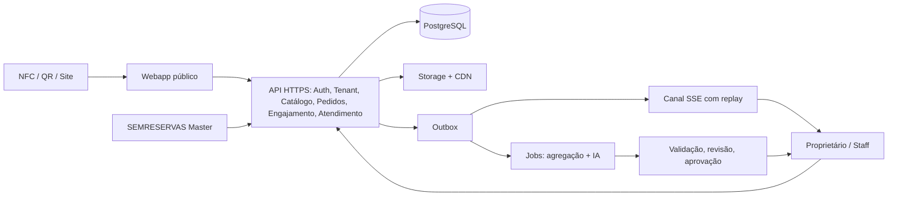
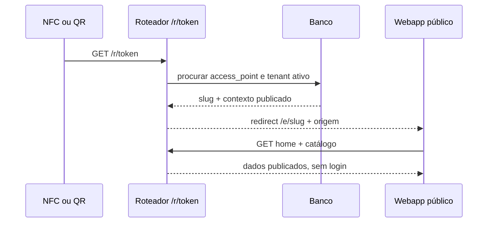
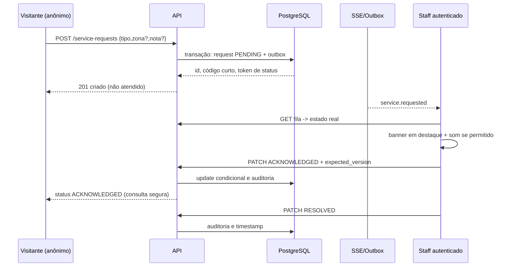
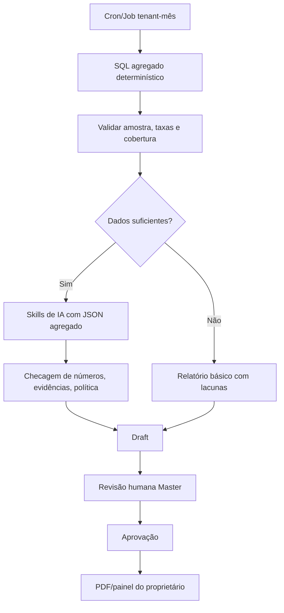
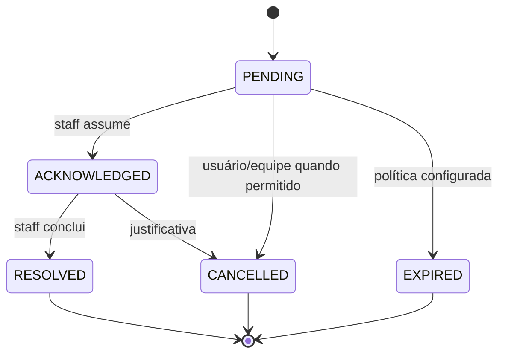

# Diagramas de arquitetura e fluxos (proposta)

## Diagrama geral

## Visitante abre a TAG

## Chamado de garçom sem número de mesa

## Relatório mensal

## Estados

O protótipo HTML usa armazenamento local do navegador e não é a implementação desses diagramas. SSE, banco, autenticação, permissões e fila são parte do MVP real a implementar.
