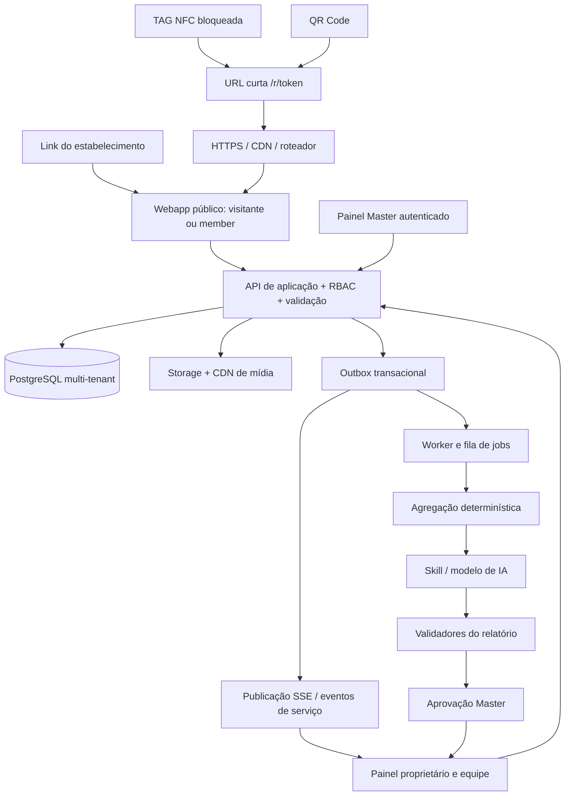
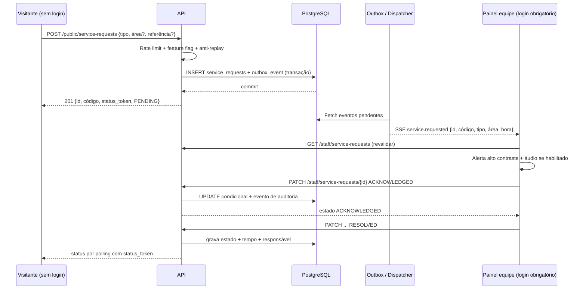

# 03 — Arquitetura técnica e comunicação entre componentes

## 1. Direção recomendada para avaliação pelo Claude Code

**Referência proposta (não homologada):** monólito modular TypeScript para API e painéis web, React para o front-end, PostgreSQL com migrações, armazenamento de imagens/vídeos em bucket compatível com S3 e CDN, processo de workers para relatórios/IA, Redis opcional para filas e limitação de taxa distribuída. Cada componente deve poder evoluir sem criar uma implantação distinta por estabelecimento. Frameworks concretos, versão da stack, hospedagem e custos devem ser propostos/justificados em ADR pelo Claude Code, após revisar esta documentação; **não tratar um nome de framework como decisão aprovada**.

### Por que começar monolítico

Um desenvolvedor com IA deve conseguir executar testes, depurar, implantar e monitorar sem sobrecarga de microserviços. Serviços lógicos são módulos dentro de uma aplicação e podem ser extraídos apenas quando demanda real justificar:

- `tenant/config`: onboarding, marca, home, unidade, contrato e flags.
- `public-catalog`: leitura pública de categorias/produtos/mídia.
- `engagement`: eventos, cliques externos, favoritos e comentários.
- `order-intent`: carrinho/resumo e confirmação humana.
- `service-desk`: chamados, estados e canal SSE.
- `loyalty`: carteira, transações, benefícios e validação.
- `campaign`: destaques e campanhas.
- `insights`: agregações, relatórios, IA e aprovação.
- `identity/access`: login, sessão, autorização e auditoria.
- `nfc-routing`: códigos públicos e reatribuição segura.

## 2. Esquema de comunicação

**Princípio:** navegação pública e ações do usuário usam HTTP/HTTPS; alterações transacionais gravam estado primeiro no PostgreSQL; notificações em tempo real são **consequência** do estado persistido, nunca substituem a gravação. SSE é transporte de atualização, não fonte de verdade.

## 3. Roteamento NFC/QR

1. Admin cria um `access_point` e recebe `public_token` opaco e único, por exemplo `/r/Q8p3...`.
2. URL curta é gravada em NTAG e testada com telefone real, inclusive em contexto com metal; depois a memória de escrita é bloqueada permanentemente quando homologada.
3. `GET /r/:token` resolve `access_point` ativo e `tenant`/unidade publicados no servidor.
4. Servidor registra `access_opened` com origem `nfc` ou `qr` somente quando distinguível. **A mesma URL gravada em NFC e impressa no QR não permite distinguir os dois meios automaticamente**; emitir tokens diferentes por origem (mas mesmo contexto de unidade) quando essa distinção for importante.
5. Responde `302/307` para `/e/:slug?origin=...`, após validação segura de slug/contexto. Evitar redirecionamento aberto.
6. Se desativado: mostrar página clara com suporte/código, sem expor dados privados.

NFC e QR não carregam credenciais de usuário nem identificação de mesa. Quaisquer parâmetros de tracking são assinados ou validados, não tratados como autorização. Para reutilização do display, reatribuir `access_point` no servidor; preservar histórico e trilha de alteração de vínculo.

## 4. Comunicação cliente ↔ API: esquema

- **Transportes:** REST/JSON via TLS; `Accept: application/json`; respostas com `request_id` para diagnóstico.
- **Catálogo/Home:** `GET /v1/public/tenants/:slug/home` e `GET /v1/public/tenants/:slug/products?category=...`; cache GET com `ETag`/revalidação de publicação.
- **Sessão pública:** identificador `visitor_session_id` de curta duração para continuidade do carrinho/abuso, com finalidades e retenção definidas. Não usar IP como ID pessoal permanente.
- **Interações:** `POST /v1/public/events/batch` com schema version, `event_id` idempotente e whitelists; não aceitar campos de tenant arbitrários para consultas privadas.
- **Seleção:** `POST /v1/public/order-intents` guarda um resumo preparado **sem criar pedido aceito no restaurante**; expõe código temporário e itens para apresentação humana. `GET` da seleção exige token secreto de capacidade ou sessão do criador.
- **Chamados:** `POST /v1/public/service-requests` com tipo, zona/nota opcional e nonce; o servidor valida recurso ligado, origem e frequência; retorna `request_id`, `public_code` de conferência e `status_token` de alta entropia (não apenas 4 dígitos). `GET .../status` exige `status_token` ou sessão habilitada.
- **Clube:** membros usam cookie/sessão autenticada; somente backend gera débitos/créditos e valida autorização da equipe.

### Convenção de respostas

Sucesso de criação: `201` e objeto com `id`, `status` e `created_at`. Erros: `{ "error": { "code": "RATE_LIMITED", "message": "Muitas solicitações", "request_id": "..." } }`. `409` em conflito de idempotência/estado, `403` sem permissão, `429` por taxa, `422` por input inválido, `503` por indisponibilidade temporária. Nunca revelar existência de tenant privado por diferença de resposta.

## 5. Comunicação em tempo real: chamado de garçom

**Transporte recomendado para MVP:** `Server-Sent Events (SSE)` com endpoint autenticado `/v1/staff/tenants/{tenantId}/service-events/stream`, ou canal equivalente protegido pelo backend. SSE é simples para eventos unidirecionais servidor → painel da equipe. Se infraestrutura/plataforma não permitir conexões duradouras, usar polling com backoff de 2–5 segundos e ETag. WebSocket não é obrigatório no primeiro corte, mas pode ser escolhido pelo Claude Code com justificativa operacional.

**Sem número de mesa:** request pode levar `service_zone_id` (configurado como Salão/Varanda/Balcão) e `locator_note` curta. Há um código de conferência. Atendente deve localizar a pessoa por proximidade/pergunta/código. Não estimar tempo de chegada se operação não souber. As zonas são suporte operacional, não geolocalização automática.

### Política de áudio

O operador precisa clicar em **"Ativar som"** para iniciar/resumir `AudioContext`. Deixar alto contraste, banner e contador permanentemente visíveis independentemente do áudio. Som opcional com controle de volume/silêncio e teste; não afirmar que tocará em background/aparelho bloqueado. Indicadores de reconexão e último evento. Após reconexão, recuperar eventos perdidos via `Last-Event-ID`/consulta de estado. Várias telas staff podem exibir mesmo chamado; ack é operação idempotente/condicional para não ter dois donos.

### Antispam e expiração

Apenas 1 chamado aberto por sessão/tipo/loja (configurável). Backoff e janelas de rate limit por origem/tenant, limites de notas e proteção de HTML. Chamados não atendidos devem exibir escalonamento visual; expiração só com política explícita e auditoria, não desaparecer silenciosamente. Métricas: solicitados, assumidos, concluídos, tempo de primeira ação, tempo até conclusão, sem números inventados.

## 6. Comunicação Master ↔ servidor ↔ consumidor

1. Master autentica com `MASTER_ADMIN` ou permissão específica de cliente delegado.
2. Edição cria `tenant_branding_draft`/`tenant_features_draft` com controle de versão.
3. Preview consulta o draft autorizado; público consulta somente `published_version`.
4. Publicação valida cores, ativos, links HTTPS confiáveis, recursos contratados, schema e dependências.
5. Servidor incrementa versão de configuração e invalida cache do tenant; próxima navegação cliente busca versão nova (ou recebe aviso opcional de atualização).
6. Auditoria registra `actor_id`, `tenant_id`, `before/after`, horário, motivo e origem.

**Observação:** o protótipo HTML atual aplica alterações imediatamente em `localStorage` para experimentar, mas a produção deve ter **draft → preview → publish → rollback**.

## 7. Comunicação proprietário ↔ dados e insights

- `GET /v1/owner/metrics?from=&to=&filters=`: dados **agregados** por tenant e período, com denominações claras. A consulta identifica tenant pelo contexto autenticado.
- `GET /v1/owner/products/:id/engagement`: comparativos visibilidade/curtidas/favoritos/intenção sem inferir venda.
- `GET /v1/owner/reports`: relatório aprovado e publicado. Master revisa rascunho. Download PDF futuro com URL assinada e expiração.
- `GET /v1/owner/comments/moderation`: permitido apenas conforme papel; política transparente de moderação.
- `GET /v1/staff/...`: staff vê fila/solicitações autorizadas; não dados pessoais de clube além dos estritamente necessários.

## 8. Integração externa: o que o navegador realmente faz

| Ação | Abordagem | Limitação |
|---|---|---|
| Instagram | Link HTTPS externo com evento de saída antes de abrir | Clique não confirma seguir/curtir |
| Avaliação Google | Link público de avaliação do estabelecimento, configurado no Master | Clique não comprova nota/publicação; não oferecer recompensa |
| WhatsApp pedido de casa | Gerar mensagem pré-preenchida e abrir link autorizado | Aberto/enviado não significa pedido aceito; confirmação humana |
| Wi-Fi guest | Mostrar SSID/senha, copiar, instruir sistema operacional | Webapp não força associação automática |
| Compartilhamento de foto | Canvas client-side + `navigator.share` quando suportado | Não confirma postagem; requer HTTPS e interação; fallback download |
| Gravação NFC | Processo operacional de provisionamento com aplicativo/ferramenta apropriada | Webapp comum não deve assumir escrita NFC em todos os telefones |
| IA de insights | Worker com credencial do servidor, nunca chave no front-end | Custo, latência, indisponibilidade, revisão humana |
| Relatórios mensais | Job agendado e fila idempotente | Não enviar automaticamente antes de revisão/aprovação inicial |

## 9. Segurança de integrações e contratos

- Não embutir secrets/API keys em HTML/JS público. Credenciais em secret manager com rotação.
- Conexões externas com timeout, circuit breaker/fallback e custo medido.
- Redirecionamento externo por allowlist segura configurada por tenant; evitar destinos maliciosos na TAG.
- Todos os jobs têm `job_id`, `idempotency_key`, tentativas limitadas e DLQ/registro de falhas.
- Persistir *outbox events* na mesma transação que ações relevantes; dispatcher reenvia de modo idempotente.
- Eventos de analytics em lote podem ser eventual consistency; service request exige transação e resposta síncrona.
- Usar schemas JSON e OpenAPI versionados e testes de contrato cliente/API.
- Tokens de status de chamados e URLs de mídia privada têm entropia, TTL e escopo; **código curto de exibição não é credencial**.

## 10. Níveis de entrega e deploy

**Ambiente local:** mocks e seed de RESTOPUB. **Staging:** demo compartilhada em HTTPS, tenants de teste, eventos sintéticos marcados e contas controladas. **Piloto:** domínio seguro, PULPO cadastrada com dados reais aprovados, logs, backups, healthcheck, monitoramento de fila, plano de rollback, termos e suporte. **Produção:** versionamento, migrações repetíveis, RBAC, isolamento, observabilidade e revisão de configuração de segurança.

Implementar pipeline: lint, typecheck, unit tests, API contract tests, SQL migrations, integração de filas/tenant isolation, e2e Playwright em browsers alvo, verificação de acessibilidade e smoke test pós-deploy. Som não pode ser testado apenas pela ocorrência de API; fazer teste manual com browser/dispositivos reais.

## 11. Alternativas tecnológicas a estudar na revisão

1. SSE vs WebSocket vs polling: custo, reverse proxy, escalabilidade, reconexão, consumo mobile.
2. Gerenciamento de sessão de visitante: cookies, armazenamento mínimo, antifraude sem rastreamento invasivo.
3. App server único vs worker separado: estabilidade dos relatórios e dos alertas.
4. Redis/BullMQ vs job no banco para escala inicial: operação e manutenção.
5. Deploy em serviço gerenciado para reduzir trabalho solo, com backup real.
6. Autenticação member (link mágico, código e-mail, Google) e custo/atrito, conforme Documento Mestre J02.
7. RLS PostgreSQL como defesa em profundidade, além de autorização na aplicação.

## 12. Fontes externas para validação técnica

- MDN: restrições de autoplay e Web Audio — https://developer.mozilla.org/en-US/docs/Web/Media/Guides/Autoplay
- MDN: compartilhar via navegador — https://developer.mozilla.org/en-US/docs/Web/API/Navigator/share
- NXP: NTAG213/215/216, bloqueio de escrita — https://www.nxp.com/products/NTAG213_215_216
- Google Maps: conteúdo proibido e avaliações incentivadas — https://support.google.com/contributionpolicy/answer/7400114

Estas referências justificam limites técnicos específicos, mas **não constituem decisão final de stack, lei, política contratual ou garantia de compatibilidade**. Avaliar novamente na implementação.
